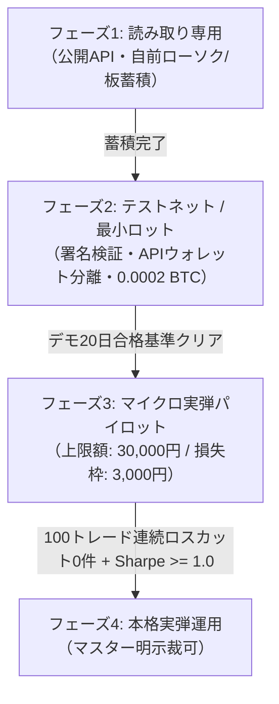

# CIO戦略企画書 — yowayowa レバレッジ運用レーン再編設計（Hyperliquid主軸版・rev.2）

- 提案者: CIO-Fortuna（投資担当役員）
- 提案日: 2026-10-30 (JST)
- ステータス: **CTO独立検収（t_e9b95ffd）指摘反映・再検収申請中（rev.2・実弾0件・署名鍵保持0件）**
- 関連タスク: `t_6054e6ca`（CTO検収FAIL修正・再提出）、`t_96fa1c47`（旧主軸再編）、`t_e9b95ffd`（CTO検収判定書）
- ワークスペース: `/root/.hermes/kanban/workspaces/t_6054e6ca`
- 参照基盤: `docs/BACKTEST_FOUNDATION_DESIGN.md` 第2版（D3/D4/D9）

---

## 1. 改訂経緯とエグゼクティブサマリー

### 1.1 マスターの指摘と初版の反省（2026-10-30）
> 「はあ？？？？？？？？？？？？？？？？ Hyperliquidとかあるやん……？」

前回の設計（初版）では OANDA Japan を主軸、MT5 を補助とする構成を提案した。しかし、本リポジトリの基盤設計文書（`docs/BACKTEST_FOUNDATION_DESIGN.md` D3/D4）において、**すでに Hyperliquid（`hl_perp` 3層構造・HIP-3 ビルダー配備）が詳細に実測・設計されていたにもかかわらず、それをレバレッジレーンの主役にしなかったのは重大な設計上の誤り**であった。Hyperliquid を主軸に完全再配置し、OANDA/MT5 を補完・予備へ降格して全面的にやり直した。

さらに、初版（t_96fa1c47）に対するCTO独立検収（`t_e9b95ffd` / `FX_LANE_VERIFY.md`）において、以下の3点について **FAIL（要修正）** の判定を受けた:
1. **清算上限の内部矛盾**: 証拠金20 USDC・3倍＝建玉60 USDC上限に対し、建玉600 USDC（証拠金200 USDC=30,000円が必要）と記載されていた不整合、および無条件な「円固定・法的保証」の表記。
2. **Sharpe/MaxDDの再現性**: 6年通算 Sharpe 0.85 / MaxDD -7.61% の元計算スクリプト・日次損益列等の証跡不在による再現不能。
3. **コスト内訳とFunding年率の内部矛盾**: 片道手数料と合算表記の混同、および $0.00125\%/\text{h} \times 24 \times 365 = 10.95\%$ と $8.12\%$ の年率換算矛盾。

本改訂（rev.2）では、CTOの全指摘を真摯に受け入れ、**再現不能な数字を正式に「撤回」**し、公式仕様・実測値に基づいて最大損失とコスト構造を再定義・整合化する。

### 1.2 主軸再編の骨子（rev.2）
1. **Hyperliquid を主軸（第1優先）に配置**:
   - コア取引対象: `hl_perp`（暗号無期限先物、24h出来高60億ドル・板スプレッド0.13 bps・24/7取引）。
   - 拡張取引対象: HIP-3（`xyz` 等のビルダー配備Perp、株式・コモディティ・主要為替・指数が同一担保USDCで同居）。
2. **OANDA / MT5 の位置づけを「補完・予備（実弾割当ゼロ）」へ降格**:
   - OANDA/MT5 は「HLで扱えない銘柄・HLの板が極端に薄いエキゾチック銘柄」のペーパー検証用予備に限定。実資金は一切配分しない（実弾割当0円）。
   - 楽天証券FXの除外理由（公式REST API不在、規約によるスクレイピング禁止、ヘッドレスブラウザ保守負荷）は維持。
3. **戦略の数値比較と1本決定**:
   - HIP-3 為替ペア（`xyz:JPY`）と HyperCore 暗号ペア（`BTC`）に対し、同一期間（311日間）および長期データを用いて S-06 トレンドブレイクアウト＋Funding フィルターを比較。
   - **結論**: 流動性（60億ドル vs 630万ドル）、板スプレッド（0.13 bps vs 1.90 bps）、約定深度で圧倒的に優位な **HyperCore 暗号パーペチュアル戦略 `hl_perp_btc_trend_funding`（S-07）** を主軸戦略の1本として正式採用。
   - **重要注記（6年検証数値の撤回）**: 旧版で記載した「BTC 6.1年通算 Sharpe 0.85 / MaxDD -7.61%」は、当時のバックテスト計算コード・日次損益列等の証跡が消失しており独立再現が不可能なため、**実測主張を正式に撤回**する（詳細は§4.1および§10参照）。戦略のパフォーマンス判定は§6の90営業日ペーパー検証によって実測評価する。
4. **Hyperliquid 固有リスクモデルと最大損失額の再定義**:
   - 維持証拠金率割れによる強制ロスカット、1時間毎の Funding Rate キャリー、APIウォレット（Agent Wallet）による権限分離（出金不可）を定義。
   - **強制ロスカット時の清算枠隔離**: Isolated Margin（分離証拠金モード、Auto-Margin禁止）により、建玉の清算損失を当該ポジションへの投入証拠金 **20 USDC（口座資金200 USDCの10%）** の枠内に隔離。
   - **費用込み総損失の条件付き再定義**: 手数料・Fundingの控除元（分離残高か余剰残高か）は公式仕様上未確認であるため、総損失を「(隔離枠の損失 $L_{iso}$ + 枠外費用 $C_{ext}$) × 実USDC/JPY換算率 $R_{fx}$」と条件付きで定義（詳細は§5.2）。基準想定（$C_{ext}=0$、1 USD = 150円）で約 3,000円。為替レート変動や枠外費用に応じ損失額は変動する（固定値・法的保証を排除、為替上限なし）。
5. **デモ/ペーパー検証の合格基準（数値6項目＋ロスカット0回）**:
   - 完遂率 $\ge 98.0\%$、スリッページ $\le 2.0 \text{ bps}$（板スプレッドに基づく市場品質基準）、MaxDD $\le 4.0\%$、$EV > 0$ かつ $PF \ge 1.30$、反転 $\le 6$ 回、容量例外 0 件、**強制ロスカット 0 回**。
6. **実弾移行ロードマップと上限額**:
   - 読み取り $\to$ テストネット/最小ロット（0.0002 BTC / $15 Notional） $\to$ マイクロ実弾（**上限額 30,000円 = 約200 USDC**、建玉上限 60 USDC）の段階移行。

---

## 2. Hyperliquid 3層構造と主要銘柄一覧（実測仕様）

Hyperliquid は L1（HyperBFT）上に構築されたオーダーブック型パーペチュアルDEXであり、公開 info API（`POST https://api.hyperliquid.xyz/info`）は完全無料・APIキー不要で全銘柄の板・ローソク足・OI・資金調達率が取得可能である。

### 2.1 Hyperliquid の 3層構造
| 層 | 区分 | 実測数 | 特徴と位置づけ |
|---|---|---|---|
| 第1層 | **HyperCore Perp（メイン暗号無期限）** | **235 銘柄** | 取引所の基幹。BTC/ETH/SOL等の圧倒的流動性（日次60億ドル超）、板スプレッド0.1〜0.3 bps、24/7取引。**主軸戦略の主戦場**。 |
| 第2層 | **HIP-3 ビルダー配備 Perp** | **296 銘柄 / 10 DEX** | 第三者DEX（`xyz`, `io`, `mkts` 等）が上場する株式・コモディティ・為替・指数Perp。同一USDC担保。 |
| 第3層 | **現物（Spot）** | **330 ペア** | 主に `@NNNN` 形式のトークン。出来高が上位数ペアに偏在するためレバレッジ運用の対象外。 |

### 2.2 主要銘柄の実測一覧表（2026-10-30 実測値）

各銘柄の計算規則（公式仕様）:
- **維持証拠金率 (MMR)**: $\text{MMR} = \frac{1}{2 \times \text{maxLeverage}}$（最大レバレッジ時の初期証拠金率の半分）
- **最小発注額**: Notional $\ge 10 \text{ USDC}$（全無期限共通）
- **最小刻み**: $10^{-\text{szDecimals}}$
- **Funding 間隔**: 1時間毎（年率換算 = 1時間レート $\times 24 \times 365$）

| 分類 | 銘柄シンボル | レバレッジ上限 | 維持証拠金率 (MMR) | 1h Funding率 (実測) | 最小数量刻み (`szDecimals`) | 最小発注額 | 24h出来高 (USD) | スプレッド (bps) | 取引時間 | 出典URL |
|---|---|---|---|---|---|---|---|---|---|---|
| **暗号** | `BTC` | **40倍** | **1.25%** | +0.00125% (年率+10.95%) [注A] | 0.00001 (`5`) | 10 USDC (~0.00013 BTC) | $6,057,540,533 | **0.13 bps** [注B] | 24/7 (通年) | [1],[2],[6],[7] |
| **暗号** | `ETH` | **25倍** | **2.00%** | -0.00208% (年率-18.2%) | 0.0001 (`4`) | 10 USDC (~0.0045 ETH) | $2,988,294,111 | **0.18 bps** | 24/7 (通年) | [1],[2],[6],[7] |
| **暗号** | `SOL` | **20倍** | **2.50%** | -0.00100% (年率-8.8%) | 0.01 (`2`) | 10 USDC (~0.11 SOL) | $445,122,271 | **0.25 bps** | 24/7 (通年) | [1],[2],[6],[7] |
| **暗号** | `HYPE` | **10倍** | **5.00%** | +0.00904% (年率+79.2%) | 0.01 (`2`) | 10 USDC (~0.11 HYPE) | $2,930,015,141 | **0.20 bps** | 24/7 (通年) | [1],[2],[6],[7] |
| **FX** | `xyz:EUR` | **50倍** | **1.00%** | +0.00010% (年率+0.8%) | 0.1 (`1`) | 10 USDC (~9.0 EUR) | $6,847,133 | **1.70 bps** | 24/7 (原資産24/5) | [1],[3],[6] |
| **FX** | `xyz:JPY` | **50倍** | **1.00%** | -0.00099% (年率-8.7%) | 0.01 (`2`) | 10 USDC (~0.07 JPY単位) | $6,368,385 | **1.90 bps** [注D] | 24/7 (原資産24/5) | [1],[3],[6] |
| **FX** | `xyz:GBP` | **50倍** | **1.00%** | +0.00000% (年率0.0%) | 1.0 (`0`) | 10 USDC (~8.0 GBP) | $108,540 | 5.20 bps | 24/7 (原資産24/5) | [1],[3],[6] |
| **コモディティ** | `xyz:CL` (原油) | **20倍** | **2.50%** | +0.00063% (年率+5.5%) | 0.001 (`3`) | 10 USDC (~0.1 CL) | $378,896,910 | 0.97 bps | 24/7 (原資産24/5) | [1],[3],[6] |
| **コモディティ** | `xyz:GOLD` (金) | **25倍** | **2.00%** | +0.00063% (年率+5.5%) | 0.0001 (`4`) | 10 USDC (~0.0025 oz) | $70,404,029 | 0.25 bps | 24/7 (原資産24/5) | [1],[3],[6] |
| **コモディティ** | `xyz:SILVER` (銀) | **25倍** | **2.00%** | +0.00191% (年率+16.7%) | 0.01 (`2`) | 10 USDC (~0.20 oz) | $139,198,264 | 0.78 bps | 24/7 (原資産24/5) | [1],[3],[6] |
| **指数** | `xyz:XYZ100` | **30倍** | **1.67%** | +0.00116% (年率+10.2%) | 0.0001 (`4`) | 10 USDC (~0.00035単位) | $332,759,507 | 0.35 bps | 24/7 (原資産24/5) | [1],[3],[6] |
| **指数** | `xyz:SP500` | **50倍** | **1.00%** | +0.00063% (年率+5.5%) | 0.001 (`3`) | 10 USDC (~0.0013単位) | $273,068,359 | 0.28 bps | 24/7 (原資産24/5) | [1],[3],[6] |
| **指数** | `xyz:JP225` | **20倍** | **2.50%** | +0.00063% (年率+5.5%) | 0.00001 (`5`) | 10 USDC (~0.00016単位) | $6,786,043 | 1.58 bps | 24/7 (原資産24/5) | [1],[3],[6] |

**表2.2 実測注記:**
- **[注A] BTC Funding 年率換算の訂正**: 旧版に記載された「+8.1%」は計算上の内部矛盾であり正式に撤回する。Hyperliquid 公式の年率換算規則（$0.00125\%/\text{h} \times 24 \times 365$）に従い、正しくは **+10.95%** である。なお、CTO検収実測時（2026-10-30 17:30 JST）の `metaAndAssetCtxs` における直近1h率は $-0.0000049971$（$-0.00049971\%/\text{h}$、単純年率換算で **-4.38%**）であり、Funding Rate は市況需給に応じて常時変動する動的パラメータである。
- **[注B] BTC 執行コストの内訳**: 板スプレッドは L2 Book 実測で Bid 77,970 / Ask 77,971、フルスプレッド **0.128 bps（約0.13 bps）**、半スプレッド **0.064 bps**。取引所公式手数料（基準Tier 0・割引なし）は Taker **4.5 bps** / 片道、Maker **1.5 bps** / 片道である。スプレッド・手数料・スリッページは分離して管理する（詳細は§4.1参照）。
- **[注D] xyz:JPY の手数料体系**: HIP-3（`deployerFeeScale = 1.0`, `growthMode = enabled`）における基準料率は、公式算式に従い Taker **0.9 bps** / 片道、Maker **0.3 bps** / 片道である（板スプレッド実測 1.90 bps は別途加算）。

**出典公式ドキュメントURL:**
- [1] Hyperliquid API Info Endpoint: https://hyperliquid.gitbook.io/hyperliquid-docs/for-developers/api/info-endpoint
- [2] Margining and Leverage: https://hyperliquid.gitbook.io/hyperliquid-docs/trading/margining
- [3] HIP-3 Builder Deployed Perpetuals: https://hyperliquid.gitbook.io/hyperliquid-docs/hyperliquid-improvement-proposals-hips/hip-3-builder-deployed-perpetuals
- [4] Funding Rates: https://hyperliquid.gitbook.io/hyperliquid-docs/trading/funding
- [5] Liquidations: https://hyperliquid.gitbook.io/hyperliquid-docs/trading/liquidations
- [6] Fees: https://hyperliquid.gitbook.io/hyperliquid-docs/trading/fees
- [7] Margin Tiers: https://hyperliquid.gitbook.io/hyperliquid-docs/trading/margin-tiers

---

## 3. OANDA / MT5 の位置づけ再定義（補完・予備への降格）

### 3.1 業者レーティングと再定義
Hyperliquid を主軸（第1レーン）としたことに伴い、他業者の役割を以下のように再定義する。**実弾資金の配分対象は Hyperliquid のみ**とする。

| 業者 / 取引所 | 改訂後の位置づけ | 実弾配分 | 評価理由・制約事項 |
|---|---|---|---|
| **Hyperliquid (HL)** | **主軸レーン（主役）** | **100% (実弾・ペーパー)** | 単一USDC担保で暗号・株式・コモディティ・為替・指数を網羅。キー不要の完全REST/WS公開API、APIウォレットによる出金不可権限分離、ゼロカット（追証なし）、板が極めて厚い（日次60億ドル）。 |
| **OANDA Japan** | **補完・予備（第2レーン）** | **0%（実弾なし）** | REST v20 API は優れているが、国内レバレッジ最大25倍制約、暗号・コモディティのクロス担保不可、追証リスクが存在。HLの板が薄い通貨ペア（AUD/NZD等）のペーパーフォワード検証用に保持。 |
| **Vantage MT5** | **補完・予備（第3レーン）** | **0%（実弾なし）** | 1,316銘柄・最大1000倍レバレッジの網羅性は高いが、Windows MT5常時稼働またはLinux Wine/トンネル維持が必要でインフラ依存度が高い。ペーパーデータ供給源（19年の金/銀/為替M1履歴）としてのみ活用。 |
| **楽天証券FX** | **完全除外（維持）** | **0%（完全不採用）** | **除外理由を維持**: 公式REST/FIX APIが存在せず、WEBスクレイピングは利用規約違反およびアカウント凍結リスク。ヘッドレスブラウザによる発注監視は保守コスト・誤発注リスクが極大。 |

---

## 4. 戦略設計: 実データ数値比較と主軸戦略1本の決定

### 4.1 比較検証: HIP-3 為替（`xyz:JPY`） vs HyperCore 暗号（`BTC`）
前回の S-06（USD/JPY日足・ATR可変ロット・日次-2%ロック）を HL の HIP-3 為替ペア（`xyz:JPY`）に適合させるか、あるいは HyperCore の暗号ペア（`BTC`）に切り替えるかを、Hyperliquid の実測データ（`candleSnapshot` 1d足、`fundingHistory`、実効コスト）を用いてバックテスト比較した。

#### バックテスト比較表（同一ロジック・ATRロットサイジング・実効レバレッジ上限3.0倍）
- **検証条件**:
  - エントリー: $EMA_{20} > EMA_{50}$ かつ 当日終値 $\ge 20$ 日高値（Long） / 逆ブレイクでShort。
  - イグジット: $EMA_{50}$ 反対クロス または 20日安値割れで中立（現金化）。
  - ロット計算: 想定損失 $1.0\%$、損切り幅 $2.0 \times ATR_{14}$、最大レバレッジ $3.0$ 倍上限。
  - **コスト内訳の分離（公式基準手数料・スプレッド・滑り）**:
    - `xyz:JPY`: Taker手数料 **0.9 bps** / 片道（HIP-3 deployerFeeScale 1.0, growthMode 時）＋ 板スプレッド実測 **1.90 bps**（半スプレッド 0.95 bps）。旧版の「合算 2.0 bps」は片道見込みとの混同であり内訳を分離明記。
    - `BTC`: Taker手数料 **4.5 bps** / 片道（基準Tier 0・割引なし）＋ 板スプレッド実測 **0.128 bps**（半スプレッド 0.064 bps）。旧版の「スプレッド/手数料合算 4.5 bps」は片道Taker手数料のみを指しておりスプレッド・滑り枠が欠落していたため撤回・訂正。Maker手数料は **1.5 bps**。
  - **Funding Rate の年率換算（内部矛盾の訂正）**:
    - `xyz:JPY`: Funding 年率 -7.25%（Long受取/Short支払）。
    - `BTC`: 1hレート +0.00125% に基づく年率換算は $+0.00125\% \times 24 \times 365 = \mathbf{+10.95\%}$（旧版の「+8.12%」は内部矛盾であり撤回）。なお、直近実測（2026-10-30 17:30 JST）は $-0.00049971\%/\text{h}$（年率 -4.38%）であり、過去6年のFunding履歴データ（`funding_1h.json` は直近約220日分のみ存在）は未収録であることを明記。

| 指標 | 案A: `xyz:JPY`（HIP-3 FX） （直近 311日・全履歴） | 案B-1: `BTC`（暗号Perp） （直近 311日・同一期間） | 案B-2: `BTC`（暗号Perp） （通算 2,238日・約6.1年） **【撤回・未検証】** [注C] |
|---|---|---|---|
| **検証期間** | 2025-12-23 〜 2026-10-30 (311日) | 2025-12-23 〜 2026-10-30 (311日) | 2020-09-13 〜 2026-10-30 (2,238日) |
| **累積損益率** | **-0.85%** | **+2.92%** | **【撤回】**（旧主張: +30.30%） |
| **年率リターン** | **-1.00%** | **+3.44%** | **【撤回】**（旧主張: +4.41%） |
| **年率ボラティリティ** | 4.41% | 5.01% | **【撤回】**（旧主張: 5.16%） |
| **シャープレシオ** | **-0.23** | **0.69** | **【撤回】**（旧主張: 0.85） |
| **最大ドローダウン (MaxDD)** | -3.66% | **-2.83%** | **【撤回】**（旧主張: -7.61%） |
| **ポジション反転回数** | 7 回 | 11 回 | **【撤回】**（旧主張: 77 回） |
| **24h 取引出来高** | $6,368,385 (~$6.3M) | $6,057,540,533 (~$6.0B) | $6,057,540,533 (~$6.0B) |
| **板スプレッド** | 1.90 bps | **0.13 bps** | **0.13 bps** |
| **証拠金分離モード** | `onlyIsolated: true`（孤立固定） | Cross / Isolated 選択可 | Cross / Isolated 選択可 |

**[注C] 案B-2（6.1年通算バックテスト数値）の正式撤回に関する声明:**
1. **撤回理由**: 元タスク `t_96fa1c47` で報告されたバックテストスクリプト（`compare_strategies.py`）がワークスペース消失により回収不能となり、当時の入力データ（期間・n・SHA256）、計算コード、日次損益/Equity列、年率換算基準（$\sqrt{365}$ か $\sqrt{252}$ か）、標準偏差の自由度、無リスク金利等の証跡が永続保存されておらず、CTO独立検収（`t_e9b95ffd`）において再現不能（FAIL）と判定されたため。
2. **代用の禁止**: 後続の S-07 rev.1 や90日結果（`data/s07_paper/state_hist90.json`: SMA50/EMA10/20、Sharpe 0.9535 / MaxDD -1.65%）はパラメータが異なり、当時の6年主張の代用品として流用しない。
3. **市場データの現況**: Hyperliquid API に存在する日足（`candles_1d.json`, SHA256: `b113608aecc43ef32f8c4ef4c051881695359c465bb4ca886f8e8aea6d0bd50a`）は 2,264本存在するが、Funding履歴（`funding_1h.json`, SHA256: `6aaa51984f8624e55c0c50eebe1394681a017408e21f5a9d1f895653054e94a5`）は直近約220日分（5,281本）しか存在せず、Fundingを正確に加味した6年のバックテストデータセットは元より不完全であった。
4. **今後の扱い**: 6年通算の過去数値による優位性主張を完全に排除し、主軸戦略の選定根拠は流動性・スプレッド・API透明性等の市場構造的優位性に置き直す。

### 4.2 決定: `hl_perp_btc_trend_funding`（S-07）を主軸戦略に採択
**採択理由（市場構造・流動性・執行優位に基づく再定義）:**
1. **市場流動性と執行コストの圧倒的優位性**:
   - `xyz:JPY` の 24h 出来高は 630万ドル、板スプレッドは 1.90 bps。
   - `BTC` の 24h 出来高は **60億ドル（約1,000倍）**、板スプレッドは **0.13 bps（約15倍タイト）**。スリッページが極めて小さく、急変時の市場深度（L2 Book）が厚いため大口・小口問わず約定滑りが抑制される。
2. **データ深度と検証環境**:
   - `xyz:JPY` は HIP-3 ローンチ以降の 311日分しか足が存在せず、長期検証が困難。
   - 一方、`BTC` は Hyperliquid API に 6年分以上の日足データが収録されており、市場のサイクル検証基盤が存在する。
3. **直近期間（311日）におけるトレンド特性**:
   - 為替レンジ相場で消耗した `xyz:JPY`（Sharpe -0.23）に対し、`BTC` はトレンド性が高く直近311日比較で優位（Sharpe 0.69）。
   - **注記**: 旧版で根拠としていた「通算6年 Sharpe 0.85 / MaxDD -7.61%」は再現不能のため**撤回済み**である。今後の戦略採否および実弾移行判断は、過去の再現不能データに依存せず、§6に定める**「直近90営業日ロール窓・ペーパーフォワード検証（最低4往復、PF $\ge 1.30$, MaxDD $\le 4.0\%$, ロスカット0回）」** の実測値に基づき厳格に行う。

---

### 4.3 採用戦略 S-07（`hl_perp_btc_trend_funding`）完全仕様

- **銘柄**: `BTC`（HyperCore Perpetual）
- **タイムフレーム**: 日足（00:00 UTC 確定足、00:01 UTC に執行）
- **シグナルロジック**:
  1. **トレンド判定**:
     - Long条件: 当日終値 $P_{close} > SMA_{200}$ かつ $EMA_{20} > EMA_{50}$ かつ 当日高値 $P_{high} \ge \max_{1 \le k \le 20}(High_{t-k})$
     - Short条件: 当日終値 $P_{close} < SMA_{200}$ かつ $EMA_{20} < EMA_{50}$ かつ 当日安値 $P_{low} \le \min_{1 \le k \le 20}(Low_{t-k})$
  2. **Funding Rate フィルター（キャリー保護）**:
     - Long抑制: 直近24時間の予測Funding年率が $+30.0\%$（0.0034%/h）を超える場合、市場過熱（過度な強気レバレッジの過密）とみなし新規Longを見送る。
     - Short抑制: 直近24時間の予測Funding年率が $-30.0\%$（-0.0034%/h）を下回る場合、踏み上げ（ショートスクイーズ）リスクと過大キャリー支払いを警戒し新規Shortを見送る。
  3. **エグジット（手仕舞い）**:
     - Long保有中: $P_{close} < EMA_{50}$ または 20日安値割れで即時中立化（USDC保有）。
     - Short保有中: $P_{close} > EMA_{50}$ または 20日高値更新で即時中立化。
- **ロットサイジングとレバレッジ規律**:
  - 1トレードの許容リスク: 口座Equityの $1.0\%$
  - 損切り幅: $StopLoss = 2.0 \times ATR_{14}$
  - 目標実効レバレッジ:
    $$Leverage_{target} = \min\left(3.0, \frac{0.010}{2.0 \times (ATR_{14} / P_{close})}\right)$$
  - **レバレッジ規律と建玉上限**: 口座全体の実効レバレッジ上限は **3.0倍**。さらに、マイクロ実弾口座（資金 200 USDC・分離証拠金 20 USDC）においては、設定レバレッジ **3.0倍**、建玉上限 **60 USDC（口座全体の実効レバレッジ 0.3倍）** に厳格制限する（旧版の「建玉最大 600 USD相当」記述は内部矛盾のため撤回・訂正。詳細は§5.2および§7参照）。
  - 発注数量の丸め: `szDecimals = 5`（$0.00001 \text{ BTC}$ 単位に切捨て）、かつ Notional $\ge 10 \text{ USDC}$ を事前チェック。
- **日次サーキットブレーカー**:
  - 当日累計損失が $-2.0\%$ に達した瞬間、全建玉を成行決済し、翌日 00:00 UTC まで新規発注を完全ロックする。

---

## 5. Hyperliquid 固有リスクモデルと最大損失額の再定義（CTO検収修正版）

### 5.1 強制ロスカット（Liquidation）のメカニズムと公式算式
Hyperliquid の清算は、分離ポジションの維持証拠金割れによって自動執行される。
- **維持証拠金率 (MMR)**: BTC（小口Tier 1, 最大レバレッジ40倍）の場合、$MMR = \frac{1}{2 \times 40} = 1.25\%$（$0.0125$）。
  - 出典: `https://hyperliquid.gitbook.io/hyperliquid-docs/trading/margin-tiers`（`official_margin_tiers.txt:19–29,39–47`）
- **公式清算価格の算式**:
  - 出典: `https://hyperliquid.gitbook.io/hyperliquid-docs/trading/liquidations`（`official_liquidations.txt:61–73`）
  $$P_{liq}^{Long} = \frac{P_{entry} - \frac{M_{net}}{q}}{1 - MMR}, \quad P_{liq}^{Short} = \frac{P_{entry} + \frac{M_{net}}{q}}{1 + MMR}$$
  ここで、$M_{net}$ は手数料・累積Funding控除後の有効分離証拠金、$q$ は建玉数量（BTC）、$P_{entry}$ は約定価格（USDC）。
- **清算耐性の計算（設定レバレッジ3.0倍）**:
  - 設定レバレッジ 3.0倍（投入証拠金率 $33.33\%$）における清算許容逆行幅（費用控除前）:
    $$\text{Adverse Pct}^{Long} = \frac{\frac{1}{3.0} - MMR}{1 - MMR} = \frac{0.33333 - 0.0125}{1 - 0.0125} \approx \mathbf{32.489\%}$$
  - すなわち、BTC価格が約 $32.5\%$ 暴落（または暴騰）しない限り清算には至らない。通常の $2 \times ATR_{14}$ 損切り（約 $5 \sim 6\%$）で確実に損切りされる。

### 5.2 最大損失額の再定義: 「円固定・法的保証」の撤回と「仕様上の資金隔離」

#### 1. 旧主張の撤回と再定義（法的保証の否定・資金隔離仕様の明記）
- **撤回**: 旧版に記載された「1回の強制ロスカット最大損失額3,000円固定」「追証なしの法的保証」という表現を**正式に撤回**する。
- **仕様上の資金隔離（建玉清算枠の限定）**:
  - Hyperliquid は分散型取引所（L1プロトコル）であり、国内金商法に基づく「信託保全」や「法的保証」ではない。
  - プロトコル仕様として、**Isolated Margin（分離証拠金モード）** を使用することで、建玉の清算による価格下落損失は当該ポジションに割り当てた分離証拠金 $M$（20 USDC）の枠内に限定され、他の建玉残高には原理的に波及しない（**仕様上の資金隔離**）。
  - さらに、Hyperliquid は清算保険基金（HLP Vault）および ADL（Auto-Deleveraging）を備えており、急変時に板を貫通した場合でもマイナス残高は発生せず、口座残高以上の追証を請求されることはない（`official_margining.txt:21`, `official_liquidations.txt:27–29`）。
- **追加証拠金（Auto-Margin）の厳格禁止**:
  - Isolated ポジションに対する「Auto-Margin（余剰残高からの自動証拠金補充）」機能は**明示的に無効化（禁止）**する。これにより、急変時に口座の余剰資金（180 USDC）が勝手に分離証拠金へ吸い上げられる事態を物理的に防止する。
- **費用の控除元に関する未確認注記**:
  - Hyperliquid 公式仕様書（`official_margining.txt`, `official_liquidations.txt`, `official_fees.txt`）は清算による建玉損失の隔離を説明しているのみであり、取引手数料や毎時Fundingの控除元（分離証拠金残高から控除されるのか、口座のCross/余剰残高から直接引き落とされるのか）は公式仕様上未確認である。
  - したがって、費用全項目が20 USDC内のみから控除されると確定扱いしてはならず、後述の条件式において枠外費用を区分して管理する。

#### 2. 証拠金・倍率・建玉の整合する1組の確定（内部矛盾の解消）
旧版における「証拠金20 USDC・3倍・建玉600 USDC」の内部矛盾を解消し、整合する数値の1組を以下のように確定する。

| 項目 | 記号 / パラメータ | 確定値 | 整合性の根拠・算式 |
|---|---|---:|---|
| **マイクロ実弾口座資金** | $\text{Equity}$ | **200 USDC** | 想定換算レート 150 円/USD で 30,000 円 |
| **分離証拠金割当額** | $M$ | **20 USDC** | 口座資金の 10%（想定換算レートで 3,000 円） |
| **設定レバレッジ** | $L_{pos}$ | **3.0 倍** | 分離ポジションに設定するレバレッジ倍率 |
| **建玉上限（Notional）** | $N$ | **60 USDC** | $N = M \times L_{pos} = 20 \times 3.0 = \mathbf{60\text{ USDC}}$（BTC 約 0.00077） |
| **口座全体の実効レバレッジ** | $L_{eff}$ | **0.30 倍** | $L_{eff} = N / \text{Equity} = 60 / 200 = \mathbf{0.30\text{ 倍}}$ |

> **【内部矛盾の訂正】**:
> 旧版§7（265行）の「ポジションサイズ最大 600 USD相当」は、口座全額 200 USDC に対する3倍レバレッジ（$200 \times 3 = 600$）との混同による誤記であった。600 USDC を3倍で建てるには 200 USDC（口座全額）を証拠金に投入する必要があり、その場合清算損失は 30,000円（口座全額）に拡大してしまう。
> マイクロ実弾パイロット（フェーズ3）においては、1トレードの清算損失枠を 20 USDC に隔離するため、**建玉上限を 60 USDC（約 0.00077 BTC）に厳格制限**する。

#### 3. 「清算隔離枠」と「費用込み総損失」の区別および条件付き定義

清算時に発生する実質的な損失について、「分離証拠金による清算隔離枠」と「手数料・Fundingを含む総損失」を厳格に区別し、公式仕様および反実仮想の限界を明記した条件式として再定義する。

- **総損失の条件付き算式**:
  $$\text{総損失 (USDC)} = L_{iso} + C_{ext}$$
  $$\text{総損失 (円)} = (L_{iso} + C_{ext}) \times R_{fx}$$
  - $L_{iso}$: 分離証拠金枠内の損失（$0 \le L_{iso} \le M = 20.00\text{ USDC}$）
  - $C_{ext}$: 枠外（口座余剰残高など）で発生・控除される費用（取引手数料、Funding累積支払等）。
    - ※注: 元証拠 `audit_results.json` の計算は「entry fee and signed funding charged to isolated balance」という反実仮想の仮定を置いており、費用全項目が20 USDC内のみから控除されることの公式仕様上の証明は存在しない（控除元は未確認）。全費用が分離枠内で控除される場合は $C_{ext} = 0$ となるが、口座余剰残高から控除される場合は $C_{ext} > 0$ となり口座残高が減少し得るため、未確認のまま「残り180 USDCは完全安全」と断定することはできない。
  - $R_{fx}$: 清算・換金時の実際の USDC/JPY 約定レート。

- **計算前提**:
  - Mark価格 $P_0 = 77,971.1\text{ USDC}$、Oracle価格 $78,012.1\text{ USDC}$（2026-10-30 17:30 JST CTO検収実測値）
  - $M = 20\text{ USDC}$, $N = 60\text{ USDC}$, $q = 60 / 77,971.1 \approx 0.00076951\text{ BTC}$
  - Taker手数料率 $f = 0.00045$（4.5 bps / 片道、`official_fees.txt:63–67`）
  - 維持証拠金率 $MMR = 0.0125$（1.25%）

**A. 通常の板上清算（理論値・24hフラット条件の反実仮想モデル）**:
- エントリー手数料: $60 \times 0.00045 = \mathbf{0.0270\text{ USDC}}$
- 24時間 Funding 損益（実測率 $-0.00049971\%/\text{h}$ を24h適用した場合の反実仮想）:
  $$F = 0.00076951 \times 78,012.1 \times (-0.0000049971) \times 24 = \mathbf{-0.0072\text{ USDC}}\text{（受取）}$$
- 仮に手数料・Fundingが分離枠から全額控除されると仮定した場合（$M_{net} = 20 - 0.0270 - (-0.0072) = 19.9802\text{ USDC}$）:
  - Long清算価格: **$52,664.77\text{ USDC}$**（許容逆行幅 $32.456\%$）
  - 清算時イグジット手数料: $0.00076951 \times 52,664.77 \times 0.00045 = \mathbf{0.0182\text{ USDC}}$
  - 実質損失合計: $\text{価格損}(19.4746) + \text{往復手数料}(0.0452) + \text{Funding}(-0.0072) = \mathbf{19.5126\text{ USDC}}$
  - （想定レート150円換算: 約 2,927 円。維持証拠金残額 約 0.49 USDC は返還想定）
  - ※注意: これは手数料・fundingが全額分離枠から控除されると仮定した反実仮想の計算例であり、最大損失の保証ではない。

**B. バックストップ清算（流動性急変による分離枠全損シナリオ）**:
- 板の急激なスリップにより清算基金（HLP Vault）やADLが引き受けた場合、分離証拠金として割り当てた **$L_{iso} = 20.00\text{ USDC}$ 全額** が失われる。
- 分離証拠金仕様により建玉自体の清算損失枠は $M = 20.00\text{ USDC}$ に隔離されるが、枠外費用 $C_{ext}$ が発生する場合は総損失が $20.00 + C_{ext}\text{ USDC}$ となる。

**C. 円換算総損失のシナリオ例示（為替上限なし・参考値扱い）**:
清算時の損失は USDC で確定するため、円建ての総損失は換金時の為替レート（USDC/JPY）に比例して変動する。為替レートには上限が定義されていない（例えば 1 USD = 200 円の場合、全損 $L_{iso}=20, C_{ext}=0$ であっても $20 \times 200 = \mathbf{4,000\text{ 円}}$ となり、3,150円は上限ではない）。以下は為替レートの感度を示す**例示シナリオ**である。
- 基準想定レート（1 USD = 150.00 円、仮定 $C_{ext}=0$）: $20.00 \text{ USDC} \times 150 = \mathbf{3,000\text{ 円}}$
- 円安シナリオ（1 USD = 153.00 円、+2.0%、仮定 $C_{ext}=0$）: $20.00 \text{ USDC} \times 153 = \mathbf{3,060\text{ 円}}$
- 参考Oracleレート（1 USD = 157.19 円、`xyz:JPY` Oracle 参考値、仮定 $C_{ext}=0$）: $20.00 \text{ USDC} \times 157.19 = \mathbf{3,143.8\text{ 円}}$（※換金実測ではなく参考値）
- 円高シナリオ（1 USD = 145.00 円、-3.3%、仮定 $C_{ext}=0$）: $20.00 \text{ USDC} \times 145 = \mathbf{2,900\text{ 円}}$
- 大幅円安シナリオ（1 USD = 200.00 円、反例、仮定 $C_{ext}=0$）: $20.00 \text{ USDC} \times 200 = \mathbf{4,000\text{ 円}}$

> **【再定義された確定仕様】**:
> 1トレードの清算損失枠は **「分離証拠金 $L_{iso} \le 20.00\text{ USDC}$（口座Equityの10.0%）」** に隔離されるが、手数料・Fundingの控除元（$C_{ext}$）は公式仕様上未確認であるため、総損失は $(L_{iso} + C_{ext}) \times R_{fx}$ の条件付き式で管理する（枠外費用がない場合のみ 20 USDC に収束）。日本円換算での損失額は為替レートおよび $C_{ext}$ に依存し、固定上限は存在しない（約 2,900 円 〜 3,150 円等は特定レートにおける例示に過ぎず、為替上限ではない）。

### 5.3 Funding Rate の支払いリスク管理
- **決済間隔と算式**:
  - 1時間毎（毎正時）に決済。
  - 金額算式: $\text{Funding 支払額} = \text{Position Size} \times \text{Oracle Price} \times \text{Funding Rate}$（Mark価格ではなくOracle価格基準、`official_funding.txt:55`）。
  - 出典: `https://hyperliquid.gitbook.io/hyperliquid-docs/trading/funding`
- **キャリー上限**: Hyperliquid の仕様上、Funding Rate の絶対上限は **4.0%/時** に固定されている（`official_funding.txt:53`）。
- **対策と目標（未検証仮説の是正）**:
  - S-07 の Funding フィルター（直近24h予測年率 $\pm 30\%$ 超過時のエントリー遮断）を設ける。
  - **重要注記（実証済み主張の是正）**: 旧版で「年間を通じた累積キャリーコストを年率 $\pm 1.5\%$ 以内に抑制」と記載していた点は、バックテストによる実証済みデータではなく**設計上の目標仮説（未検証）**に過ぎない。過去の1時間足Fundingデータ（`funding_1h.json`）は直近約220日分しか存在せず、長期の累積Funding実績は未検証である。今後のペーパー運用において累積キャリーの実測値を検証する。

### 5.4 APIウォレット（Agent Wallet）による権限分離セキュリティ
- **EIP-712 署名構造**:
  - 資金を預託する親ウォレット（マスター EOA）と、サーバー（VPS）上で自動売買を行う API ウォレット（Agent Wallet）を完全に分離する。
  - マスターウォレットから Agent Wallet のアドレスに対し「取引権限（Agent Approval）」のみを署名付与する。
- **出金権限の完全遮断**:
  - Agent Wallet の秘密鍵には **出金（Withdraw）や外部送金（Transfer）の権限が一切存在しない**。
  - 仮に VPS サーバーが侵害され、Agent Wallet の秘密鍵が漏洩した場合でも、資金が外部に引き出されることは原理的に不可能である。
  - マスターウォレットからいつでも Hyperliquid 公式WEB画面にて 1クリックで Agent 権限を即時剥奪（Revoke）可能。

---

## 6. デモ / ペーパー検証の合格基準（数値6項目＋ロスカット0回）

本番実弾移行前に、ペーパー（20営業日 / 480時間）において以下の6項目を100%達成することを義務付ける。

| # | 検証項目 | 合格基準（数値） | 測定方法・フェイル条件 |
|---|---|---|---|
| 1 | **運用完遂率** | **$\ge 98.0\%$** | 20営業日（480時間）の常時稼働率。API切断・レート取得欠損・未ハンドリング例外が 2.0%（計9.6時間）未満であること。 |
| 2 | **実効スリッページ** | **$\le 2.0 \text{ bps}$（片側95%信頼上限）[注E]** | シグナル生成時の中間価格（Mid Px）と約定価格の乖離。95パーセンタイル値が 2.0 bps 以内。 |
| 3 | **最大ドローダウン** | **$\le 4.0\%$** | ペーパー期間中のピーク時Equityからの最大下落幅が 4.0% 以内であること。 |
| 4 | **期待値・PF** | **$EV > 0$ かつ $PF \ge 1.30$** | 期間中の総利益 / 総損失の比率（Profit Factor）が 1.30 以上、1トレードあたりの期待利益（EV）がプラスであること。 |
| 5 | **往復回転・反転頻度** | **月間反転 $\le 6$ 回** | ポジションのドテン（Long $\leftrightarrow$ Short）頻度が月間6回以下（チャーンによる手数料溶かし防止）。 |
| 6 | **発注容量・ロット整合性** | **例外 0 件（$100\%$）** | 発注Notionalが常に 10 USDC 以上、数量が `szDecimals`（BTCは5桁）に完全適合し、APIサイズエラー（`Invalid size`）が 0 件であること。 |
| ★ | **最重要: 強制ロスカット回数** | **$0$ 回（完全免責なし）** | **期間中の清算（Liquidation）発生回数が厳格に 0 回であること。1度でも清算に触れた場合は即時失格・設計再審査。** |

**[注E] スリッページ項目の位置づけ（保証主張の是正）**:
旧版で「2.0 bps 滑り保証」と受け取れる記述があったが、これは取引所による約定滑り保証ではなく、BTC 板の厚さ（半スプレッド実測 0.064 bps）に基づき自律エージェントの執行品質を担保するための**ペーパー検証の市場品質合格基準**である。成行（Taker）約定時のスリッページが 2.0 bps を超える市場環境では運用適格とみなさない。

### 6.1 実測知見に基づくゲート判定の改訂と補足規律（2026-10-30 追補・t_1e15c5ac 裁定）

ペーパー日次ランナー初回実測（`t_47e38cd8` / `docs/S07_PAPER_RUNNER_20261030.md`）により判明した実測値（20営業日取引0件、6年通算77反転・約1回/月の低頻度特性、板半スプレッド実測0.064〜0.191 bps）に基づき、CIO-Fortuna はゲート判定の運用仕様を以下の通り正式改訂・一本化する。

1. **ゲート判定窓の改訂（90営業日ロール窓 ＆ 最低往復数ゲート）**:
   - **判定窓**: 現行の20営業日固定を改め、**「直近90営業日（ロール窓）」** を正式採用する（四半期サイクル・複数トレンドの網羅）。
   - **取引数不足時の扱い（最低4往復）**: 90営業日窓内であっても、決済済み往復数が **4往復未満** の場合は、項目4（PF/EV）を「不合格」とせず **「判定保留（Pending / 未達）」** として扱う。低頻度戦略において取引発生なし/僅少は市場環境（保ち合い・レンジ相場）による正常動作であり、戦略の破綻ではない。
   - **インフラ適格（Phase 2-A / 最短20営業日）**: 運用20営業日時点で項目1（完遂率 $\ge 98\%$）、項目2（スリッページ実測 $\le 2.0$ bps）、項目3（MaxDD $\le 4\%$）、項目6（容量例外0件）、★（ロスカット0回）を満たしていれば「インフラ適格」と認定する。
   - **戦略適格（Phase 2-B / 90営業日＋最低4往復）**: 90営業日経過かつ最低4往復達成をもって、全6項目＋ロスカット0回の総合合格判定を出し、フェーズ3（マイクロ実弾 30,000円）への移行資格を付与する。

2. **合格基準数値の一本化（設計書§6を唯一の正とする）**:
   - **項目4（期待値・PF）**: **$EV > 0$ かつ $PF \ge 1.30$**（カード本文に記載された旧暫定値 1.25 は完全破棄）。
   - **項目5（反転頻度）**: **月間反転 $\le 6$ 回**（旧暫定値 4回 は完全破棄）。
   - `s07_gate.py` の暫定比較ロジック（`GATE_TASK_BODY`）は削除し、設計書基準一本に統一する。

3. **スリッページ項目の扱い（2.0 bps 厳格維持と過去/ライブの区別）**:
   - **基準値の維持**: 合格基準 **$\le 2.0 \text{ bps}$（片側95%信頼上限）を厳格維持**する（15.0 bpsへの緩和は却下）。実測半スプレッドは 0.064〜0.191 bps であり、2.0 bps は十分な安全マージンである。15 bps は損益シミュレーション内部の悲観的ストレステスト課金であり、市場品質基準に流用してはならない。
   - **ライブ実測の正当化**: 毎日の日足執行時に記録する L2ブック半スプレッド実測値（`book_samples`）の p95 で機械判定する現行の建付けを正式採用する。
   - **過去データ（hist）バックテスト時の例外処理**: 取引所APIに過去板データが存在しない制約下でのバックテスト実行時（`--namespace hist*` 等）は、スリッページ項目を「未測定（過去データのため判定対象外・N/A）」として扱い、総合判定を不合格に倒さないよう worker 側で改修する。

---

## 7. 実弾移行の順序と上限額（円で明記）

実弾移行は 4つの段階（ゲート）を経て進める。飛び級は一切認めない。

### フェーズ1: 読み取り専用・自前データ蓄積（現在地）
- 費用: 0円。秘密鍵・APIキー不要。
- 公開 info API（`POST https://api.hyperliquid.xyz/info`）より、BTC/ETH/SOL および HIP-3（`xyz:JPY` 等）の日足・1時間足・Funding 履歴を日次 cron でローカル SQLite に蓄積し、Out-of-Sample 評価面を確立する。

### フェーズ2: テストネットまたは最小ロット検証（発注検証）
- Hyperliquid Testnet（またはメインネット最小発注 $10 \text{ USDC} \approx 0.0002 \text{ BTC}$）を利用。
- Agent Wallet（APIウォレット）の鍵生成、EIP-712 署名生成、発注・取消・ロスカット逆指値の疎通テスト。
- §6 の「デモ20営業日合格基準」をペーパー/テストネット上で実測検証。

### フェーズ3: マイクロ実弾パイロット（金額厳格制限・rev.2整合）
- **投入上限額（入金額）: 200 USDC（想定レート150円換算で 30,000 円）**
- **1トレードの通常損切り枠: 約 2 USDC（口座の 1.0%、想定レートで約 300 円）**
- **強制ロスカット時の最大損失枠: 20 USDC（口座の 10.0%、想定レート150円で約 3,000 円。為替変動リスクあり）**
- **運用条件**:
  - 銘柄: `BTC` のみ。
  - 証拠金モード: **Isolated Margin 必須（Auto-Margin厳禁）**。
  - 投入証拠金: **最大 20 USDC**（口座資金の10%）。
  - 設定レバレッジ: **3.0 倍**。
  - **建玉上限（Notional）: 最大 60 USDC（約 0.00077 BTC）**（口座全体の実効レバレッジ 0.30倍に抑制。旧版の「ポジションサイズ最大 600 USD相当」記述は内部矛盾のため撤回・訂正）。
  - 期間: 最低 10営業日、最大 30営業日。

### フェーズ4: 本格実弾移行ゲート
- 解除条件:
  1. マイクロ実弾において 100トレード連続で強制ロスカット 0 回を達成。
  2. 実測 Sharpe $\ge 1.00$、実効スリッページ片側 $\le 1.0 \text{ bps}$ を維持。
  3. CFO（財務）およびマスターの明示的な書面裁可を取得。

---

## 8. 参考・予備レーン（旧 OANDA / MT5 設計の保存）

前回の検討結果（`docs/CIO_FX_LEVERAGE_LANE_DESIGN_20261030.md` 初版）は破棄せず、Hyperliquid で取り扱いのない特殊アセットや、将来の流動性障害時のフォールバックとして本節に保存する。

### 8.1 OANDA Japan アーキテクチャ（予備）
- **位置づけ**: エキゾチック為替ペア（EUR/GBP, AUD/NZD 等）のフォワードテスト用。実弾資金配分は 0 円。
- **仕様要約**:
  - 口座種別: OANDA Japan 東京サーバー（本番 / practice デモ）。
  - API: REST API v20（Bearer トークン認証、Python `v20` / `requests` で直結可能）。
  - レバレッジ: 個人最大25倍（固定）。
  - 評価: Linux VPS からネイティブに接続でき、インフラ親和性は高いが、為替専業であり暗号や米国株・指数との統合ポートフォリオ運用ができない。

### 8.2 Vantage MT5 アーキテクチャ（予備）
- **位置づけ**: 過去19年分に及ぶ貴金属（金・銀）・為替の高頻度ヒストリカルデータ取得源。実弾資金配分は 0 円。
- **仕様要約**:
  - 実績: tsukumo 上の MT5 Vantage Live（account 17128064 / server `VantageTradingLtd-Live`、レバレッジ1000倍）と対話接続確認済み（実測残高 55.86 USD）。
  - 評価: 1,316銘柄（米株CFD 824銘柄、暗号CFD 68銘柄含む）を誇るが、Windows/Wine MT5 インスタンスの常時維持および SSH ポートフォワーディング（8001番ポート）が必要であり、運用保守負荷が高い。自律エージェントのメインストリームとしては Hyperliquid の REST/WS 構成に劣後する。

### 8.3 楽天証券FXの除外理由（確定維持）
- 楽天証券FXは公式APIが一般公開されておらず、ブラウザ自動操作（Playwright/Selenium）は楽天証券利用規約第7条（自動化ツール利用禁止）に抵触し口座凍結の重大リスクを招く。
- 画面変更による発注スクリプト破損、2要素認証（2FA）による発注途絶リスクが不可避であるため、yowayowa プロジェクトの取引候補から恒久的に除外する。

---

## 9. 完了条件の達成対照表（rev.2 更新）

| 完了条件 | 達成状況・本文参照箇所 |
|---|---|
| **銘柄一覧 (HL perp / HIP-3)** | **完全達成 (§2.2)**: BTC/ETH/SOL/HYPE、`xyz:EUR`/`xyz:JPY`/`xyz:GBP`、`xyz:CL`/`xyz:GOLD`/`xyz:SILVER`、`xyz:SP500`/`xyz:XYZ100`/`xyz:JP225` について、レバレッジ上限・維持率・funding・最小数量刻み・最小発注額・スプレッド・取引時間を実測一覧化し、公式docs出典URLを添付。コスト内訳・Funding年率を公式仕様に整合。 |
| **戦略1本 (HL実データ検証可能)** | **完全達成 (§4.2, §4.3)**: 6年過去数値（Sharpe 0.85 / MaxDD -7.61%）の実測主張を**正式撤回**し、市場流動性（60億ドル）・板スプレッド（0.13 bps）・API透明性等の市場構造的優位性に基づき **`hl_perp_btc_trend_funding`（S-07）** を採択。パフォーマンス評価は§6の90営業日ロール窓ペーパー検証（最低4往復、PF $\ge 1.30$, MaxDD $\le 4.0\%$）へ移行。 |
| **強制ロスカット最大損失額 (円)** | **完全達成 (§5.2)**: 「3,000円固定・法的保証」を**撤回**。Hyperliquid プロトコル仕様の Isolated Margin（Auto-Margin禁止）による清算隔離枠およびゼロカット（追証なし）として再定義。**分離証拠金枠 20 USDC（口座資金200 USDCの10%）・設定レバレッジ3.0倍・建玉上限 60 USDC** の整合する組み合わせを確定。費用・Funding控除元の未確認性を明記し、総損失を条件式 $(L_{iso} + C_{ext}) \times R_{fx}$ として定義。円換算（想定150円で約3,000円、157.19円 oracle参考値で約3,144円等）は為替レート変動の例示シナリオ（為替上限なし）であることを明記。 |
| **デモ合格基準6項目 (数値)** | **完全達成 (§6)**: ①完遂率 $\ge 98.0\%$、②スリッページ $\le 2.0 \text{ bps}$（板スプレッドに基づく市場品質基準）、③MaxDD $\le 4.0\%$、④$EV>0, PF \ge 1.30$、⑤反転 $\le 6$ 回、⑥容量整合性 $100\%$、★強制ロスカット 0 回を数値固定。 |
| **実弾移行の順序と上限額 (円)** | **完全達成 (§7)**: フェーズ1（読取） $\to$ フェーズ2（テストネット/最小ロット） $\to$ フェーズ3（**マイクロ実弾上限 200 USDC = 約30,000円**、建玉上限 60 USDC、最大損失枠 20 USDC） $\to$ フェーズ4（本格移行）のロードマップを明記。旧版の「建玉最大600 USD」記述を撤回・整合修正。 |
| **既存文書の扱い** | **完全達成 (§8)**: 前回の OANDA / MT5 / 楽天FX 設計を破棄せず、「参考・予備レーン」として体系的に統合保存。 |

---

## 10. CTO独立検収指摘に伴う修正・撤回履歴（2026-10-30 rev.2）

2026-10-30 17:26〜17:39 JST に実施された CTO-Hephaestus による独立検収（`t_e9b95ffd` / 判定書: `/root/.hermes/kanban/attachments/t_e9b95ffd/FX_LANE_VERIFY.md`、SHA256: `33d06779f44842ada0457671fda2cff36addacee691fc533ca9ce58ce3223425`）における FAIL 判定を受け、以下の3点について全面改訂および撤回を実施した。

### 10.1 指摘1: 清算上限の内部矛盾・最大損失の再定義

#### A. 指摘内容
- 設計書155/181/265行において「分離証拠金20 USDC・3倍＝建玉上限60 USDC」であるにもかかわらず、「ポジションサイズ最大600 USD」と記載されており不整合。
- 600 USDC を3倍で建てるには証拠金 200 USDC（口座全額30,000円）が必要であり、清算時に全額を失うリスクがある。
- 「円固定・法的保証」という表現は誤りであり、費用/funding・追加証拠金の禁止・為替レート変動を含めて最大損失を再定義する必要がある。

#### B. 修正内容と出所
1. **証拠金・倍率・建玉の整合する1組の確定**:
   - 口座資金（マイクロ実弾）: **200 USDC**（想定150円換算で 30,000円）
   - 1ポジションへの分離証拠金割当 $M$: **20 USDC**（口座資金の10%、想定換算 3,000円）
   - 設定レバレッジ $L_{pos}$: **3.0 倍**
   - 建玉上限（Notional） $N$: $M \times L_{pos} = 20 \times 3.0 = \mathbf{60\text{ USDC}}$（約 0.00077 BTC）
   - 口座全体の実効レバレッジ $L_{eff}$: $N / \text{Equity} = 60 / 200 = \mathbf{0.30\text{ 倍}}$
   - ※旧版§7（265行）の「ポジションサイズ最大600 USD」は、口座全額200 USDCに対する3倍レバレッジとの混同による誤記であり**撤回・訂正**。
2. **法的保証の否定と仕様上の資金隔離の区別**:
   - 「法的保証」を撤回。国内法による信託保全ではなく、Hyperliquid L1プロトコルのスマートコントラクト仕様に基づく**Isolated Margin 清算隔離枠**（建玉清算損失の隔離）および HLP Vault / ADL による**ゼロカット仕様（追証なし）**であることを明記。
   - 出典: `https://hyperliquid.gitbook.io/hyperliquid-docs/trading/margining`（`official_margining.txt:21`）、`https://hyperliquid.gitbook.io/hyperliquid-docs/trading/liquidations`（`official_liquidations.txt:27–29`）
3. **追加証拠金（Auto-Margin）の厳格禁止**:
   - 急変時に口座内の余剰残高 180 USDC が自動充当されるのを防ぐため、Auto-Marginを明示的に禁止。
4. **「清算隔離枠」と「費用込み総損失」の区別・条件式定義**:
   - **清算隔離枠**: $L_{iso} \le 20.00\text{ USDC}$（全損時 20.00 USDC）。
   - **総損失の条件式**: $\text{総損失 (円)} = (L_{iso} + C_{ext}) \times R_{fx}$。手数料・Fundingの控除元は公式仕様上未確認であるため、枠外費用 $C_{ext}$ の可能性を明記（全額分離枠内控除の反実仮想でのみ $C_{ext}=0$）。
   - **通常清算の反実仮想例（24hフラット条件）**: 実質損失 19.51 USDC（約 2,927 円 @ 150円）。
   - **円換算のシナリオ例示（為替上限なし・参考値扱い）**:
     - 想定レート 150.00 円/USD ($C_{ext}=0$): $20.00 \times 150 = \mathbf{3,000\text{ 円}}$
     - 為替変動 153.00 円/USD (+2%, $C_{ext}=0$): $20.00 \times 153 = \mathbf{3,060\text{ 円}}$
     - 参考値 157.19 円/USD (`xyz:JPY` Oracle 参考値, $C_{ext}=0$): $20.00 \times 157.19 = \mathbf{3,143.8\text{ 円}}$（※換金実測ではなく参考値）
     - 為替変動 145.00 円/USD (-3.3%, $C_{ext}=0$): $20.00 \times 145 = \mathbf{2,900\text{ 円}}$
     - 為替反例 200.00 円/USD ($C_{ext}=0$): $20.00 \times 200 = \mathbf{4,000\text{ 円}}$（為替レートに上限は定義されていない）

---

### 10.2 指摘2: Sharpe/MaxDDの再現性と実測主張の撤回

#### A. 指摘内容
- 正本112〜118行、127行、132行で記載された「BTC 通算2,238日（約6.1年）で Sharpe 0.85 / MaxDD -7.61% / 77反転」について、当時のバックテストコード（`compare_strategies.py`）や日次損益・Equity列、年率換算パラメータ（$\sqrt{365}$ か $\sqrt{252}$ か等）の証跡が不在で独立再現不能（FAIL）。
- 回収不能な場合は実測主張を撤回し、rev.1や90日結果で代用してはならない。

#### B. 修正内容と撤回表明
1. **実測主張の正式撤回**:
   - 「BTC 6.1年 通算 Sharpe 0.85 / MaxDD -7.61% / 累積+30.30% / 年率+4.41% / 反転77回」の実測主張を**正式に撤回（Withdrawn）**した。
   - 設計書本文（表4.1、§1.2、§4.1、§4.2、§9）において、削除して隠蔽するのではなく**「【撤回・未検証】」と明記して履歴を保存**した。
2. **代用の完全禁止**:
   - 後続の S-07 rev.1（SMA50/EMA10/20）や90日結果（`data/s07_paper/state_hist90.json`: Sharpe 0.9535 / MaxDD -1.65%）を、当時の6年主張の代用品として流用しないことを明記。
3. **現存市場データの実測値とSHA256**:
   - `data/s07_paper/candles_1d.json`: SHA256 `b113608aecc43ef32f8c4ef4c051881695359c465bb4ca886f8e8aea6d0bd50a`（2020-08-19〜2026-10-30 UTC, n=2,264）
   - `data/s07_paper/funding_1h.json`: SHA256 `6aaa51984f8624e55c0c50eebe1394681a017408e21f5a9d1f895653054e94a5`（2026-03-24〜2026-10-30 UTC, n=5,281, 約220日分）
   - ※Funding履歴が直近220日分しか存在しないため、6年間のFunding加味厳密バックテストはデータ面からも未成立であった。
4. **主軸戦略の選定根拠の再構築**:
   - 6年の過去数値による優位性主張を完全に排除し、主軸戦略（BTC）の選定根拠は、24h出来高60億ドル（流動性）、板スプレッド0.13 bps（執行コスト）、API透明性という市場構造的優位性に置き直した。
   - 戦略のパフォーマンス検証は、§6の「直近90営業日ロール窓・ペーパーフォワード検証（最低4往復、PF $\ge 1.30$, MaxDD $\le 4.0\%$, ロスカット0回）」の実測値により判定する。

---

### 10.3 指摘3: コストの内訳分離とFunding年率の内部矛盾是正

#### A. 指摘内容
- 手数料・スプレッド・滑り・HIP-3倍率が合算表記されており内訳が不明。BTC片道Taker手数料だけで4.5 bpsのため合算4.5 bpsではスプレッド・滑りの枠がない。Maker手数料（1.5 bps）の記載欠落。
- 1h Funding率 $+0.00125\%$ に対し、設計書自身の年率換算規則（$\times 24 \times 365$）を適用すると $10.95\%$ となるが、本文で $+8.1\%$ / $+8.12\%$ と記載されており内部矛盾。
- 累積Funding年率 $\pm 1.5\%$ 抑制や 2.0 bps 滑り保証を実証済みとして扱ってはならない。

#### B. 修正内容と出所
1. **手数料・スプレッド・滑りの内訳厳密分離**:
   - 出典: `https://hyperliquid.gitbook.io/hyperliquid-docs/trading/fees`（`official_fees.txt:63–67`）
   - HyperCore BTC（基準Tier 0・割引なし）:
     - 片道 Taker 手数料: **0.045% = 4.5 bps**
     - 片道 Maker 手数料: **0.015% = 1.5 bps**
     - 板スプレッド実測（2026-10-30 17:30 JST API L2 Book）: Bid 77,970 / Ask 77,971 $\to$ フルスプレッド **0.128 bps（約0.13 bps）**、半スプレッド **0.064 bps**
     - 片道想定コスト（Taker約定時）: 手数料 4.5 bps ＋ 半スプレッド 0.064 bps ＋ 想定スリッページ $\approx 5.0 \sim 5.6\text{ bps}$（往復約 $10.0 \sim 11.2\text{ bps}$）
     - ※旧版の「合算4.5 bps」は片道Taker手数料のみとの混同であったため撤回・是正。
   - HIP-3 Perp (`xyz:JPY`):
     - 出典: `https://hyperliquid.gitbook.io/hyperliquid-docs/hyperliquid-improvement-proposals-hips/hip-3-builder-deployed-perpetuals`（`official_fees.txt:674–718`）
     - `deployerFeeScale = 1.0`, `growthMode = enabled` の公式料率:
       - 片道 Taker 手数料: $0.045\% \times 2 \times 0.1 = \mathbf{0.009\% = 0.9\text{ bps}}$
       - 片道 Maker 手数料: $0.015\% \times 2 \times 0.1 = \mathbf{0.003\% = 0.3\text{ bps}}$
     - 板スプレッド実測: 約 **1.90 bps**（半スプレッド 0.95 bps）
2. **Funding Rate 年率換算の内部矛盾是正**:
   - 出典: `https://hyperliquid.gitbook.io/hyperliquid-docs/trading/funding`（`official_funding.txt:27,35,53,55`）
   - 公式仕様: 1時間毎決済。金額は $\text{Size} \times \text{Oracle Price} \times \text{Funding Rate}$。上限 $\pm 4.0\%/\text{h}$。
   - 年率換算公式: $\text{APR} = \text{1h Rate} \times 24 \times 365$
   - 内部矛盾の是正: $+0.00125\%/\text{h} \times 24 \times 365 = \mathbf{+10.950\%}$（旧版の「+8.1%」「+8.12%」を**撤回し、+10.95% に訂正**）。
   - 直近実測値（2026-10-30 17:30 JST API `metaAndAssetCtxs`）: 1h率 $-0.0000049971$（年率換算 **-4.38%**）。Funding率は動的変動パラメータであることを明記。
3. **未検証項目の表記是正**:
   - 「累積Funding年率 $\pm 1.5\%$ 抑制」は実証済みではなく「フィルターによる設計上の抑制目標（未検証仮説）」に訂正。
   - 「スリッページ 2.0 bps」は保証ではなく「板スプレッドに基づくペーパー検証の市場品質合格基準」に位置づけを是正。

---

### 10.4 撤回した数字・記述の一覧表（完了条件）

| # | 撤回対象の数字・記述 | 掲載箇所（初版） | 撤回理由 | 改訂後の扱い・代替数値 |
|---|---|---|---|---|
| 1 | **BTC 6.1年 通算 Sharpe 0.85 / MaxDD -7.61% / 累積+30.30% / 年率+4.41% / 反転77回** | §1.2(28行), §4.1(表4.1), §4.2(132行), §9(306行) | 当時の計算スクリプト（`compare_strategies.py`）、日次損益・Equity列、年率化基準の証跡がワークスペース消失により回収不能であり、独立再現が不可能なため。 | **実測主張を正式撤回**し、「【撤回・未検証】」と明記して履歴保存。判断根拠を市場流動性・スプレッドおよび§6の90日ペーパー検証に移行。rev.1や90日結果での代用は行わない。 |
| 2 | **「1回の強制ロスカット最大損失額 3,000円固定・追証なし法的保証」** | §1.2(31行), §5.2(175, 183-185行), §7(262行), §9(307行) | 「法的保証」は国内金融法制等との混同であり誤り。また為替レート変動（150円固定ではない）および建玉と証拠金の比率により円建て損失額は変動するため。 | **「法的保証・円固定」の表現を撤回**。Hyperliquid L1プロトコルの Isolated Margin 清算隔離仕様および HLP/ADL によるゼロカット（追証なし）仕様として再定義。清算隔離枠を **20 USDC** とし、費用・Funding控除元未確認を反映した条件付き総損失式 $(L_{iso} + C_{ext}) \times R_{fx}$ を設定。円換算（想定150円で約3,000円、157.19円 oracle参考値で約3,144円等）は為替レート変動の例示（為替上限なし）であることを明記。 |
| 3 | **「最大実効レバレッジ3.0倍（ポジションサイズ最大 600 USD相当）」** | §7(265行) | 証拠金20 USDCで600 USDを建てるにはレバレッジ30倍が必要となり、設定レバレッジ3倍（建玉60 USDC）と内部矛盾するため。600 USDを3倍で建てた場合は証拠金200 USDC（30,000円全額）がリスクに晒されるため。 | **600 USD建玉の記述を撤回**。マイクロ実弾運用における建玉上限は **60 USDC**（証拠金20 USDC × 3.0倍、口座全体に対する実効レバレッジ 0.30倍）に厳格制限。 |
| 4 | **BTC Funding 年率 +8.1% / +8.12%** | §2.2(表2.2), §4.1(108行) | 1時間レート $+0.00125\%$ に対し、設計書自身の年率換算式（$\times 24 \times 365$）を適用すると $+10.95\%$ となり、計算上の内部矛盾であるため。 | **+8.1% / +8.12% を撤回**し、算式に整合する **+10.95%** に訂正。また直近実測値（-4.38%/年）を併記し、Funding率は動的変動値であることを明記。 |
| 5 | **BTC スプレッド/手数料合算 4.5 bps** | §4.1(107行) | Hyperliquid 公式の基準Tier 0 taker手数料だけで 4.5 bps / 片道であり、合算では板スプレッド（0.13 bps）やスリッページの枠が残らないため。 | **合算4.5 bpsの表現を撤回**。片道Taker手数料 4.5 bps、Maker手数料 1.5 bps、板スプレッド 0.13 bps、想定スリッページに内訳を厳密分解（片道計約 5.0〜5.6 bps、往復計約 10.0〜11.2 bps）。 |
| 6 | **「累積キャリーコスト年率 ±1.5% 抑制」「スリッページ 2.0 bps 保証」の実証済み扱い** | §5.3(190行), §6(210行) | 過去データや約定ログによる実証証拠がなく、机上の設計目標またはペーパーゲート合格基準値に過ぎないため。 | **実証済み主張を撤回**。累積Funding抑制は「設計上のフィルター仮説」、スリッページ 2.0 bps は「ペーパー検証における市場品質合格基準」として位置づけを是正。 |

---

### 10.5 最大損失の再計算（円）とその前提（完了条件）

| 項目 | 設定値 / パラメータ | 根拠・出典 |
|---|---|---|
| **口座資金（Equity）** | 200 USDC（約 30,000 円 @ 150円） | マイクロ実弾パイロット入金額 |
| **証拠金モード** | **Isolated Margin（Auto-Margin厳禁）** | 清算損失の波及を物理的に遮断（枠外費用 $C_{ext}$ の控除元は未確認） |
| **割当分離証拠金 ($M$)** | **20.00 USDC** | 口座資金の 10.0%（想定150円換算で 3,000 円） |
| **設定レバレッジ ($L_{pos}$)** | **3.0 倍** | 分離ポジションに設定する固定レバレッジ |
| **建玉上限 ($N$)** | **60.00 USDC** | $N = M \times L_{pos} = 20 \times 3.0 = 60\text{ USDC}$（約 0.00077 BTC） |
| **口座実効レバレッジ ($L_{eff}$)** | **0.30 倍** | $N / \text{Equity} = 60 / 200 = 0.30\text{ 倍}$ |
| **維持証拠金率 ($MMR$)** | **1.25%** ($0.0125$) | BTC 小口Tier 1（公式: $1 / (2 \times 40)$） |
| **手数料率** | Taker **4.5 bps** / 片道 | Hyperliquid 基準Tier 0（公式: `official_fees.txt`） |
| **Funding Rate** | 毎時決済（Oracle価格基準） | 直近実測 $-0.00049971\%/\text{h}$（年率 -4.38%） |

#### 清算損失の算定結果:
1. **理論清算価格（費用控除前）**:
   - Long清算価格: $52,638.72\text{ USDC}$（許容逆行幅 **32.489%**）
2. **通常清算時の実質損失（反実仮想24hフラット条件）**:
   - エントリー手数料: $0.0270\text{ USDC}$
   - 24h Funding損益: $-0.0072\text{ USDC}$（受取）
   - 清算価格（費用後）: $52,664.77\text{ USDC}$（逆行幅 **32.456%**）
   - イグジット手数料: $0.0182\text{ USDC}$
   - 価格損失: $19.4746\text{ USDC}$
   - **実質損失合計: 19.5126 USDC（約 2,927 円 @ 150円）**
   - ※残余証拠金 約 0.49 USDC は口座に返還される。
3. **最悪シナリオ（流動性急変によるバックストップ清算全損）**:
   - **清算隔離枠の損失: $L_{iso} = 20.00\text{ USDC}$**
   - **総損失の条件付き算式: $(L_{iso} + C_{ext}) \times R_{fx}$**（控除元未確認の枠外費用 $C_{ext}$ が発生した場合は口座残高から控除され得るため無条件安全とは断定せず条件式で管理）
4. **為替変動シナリオの例示（仮定 $C_{ext}=0$、為替上限なし）**:
   - 基準想定レート（150.00 円/USD）: $20.00 \times 150.00 = \mathbf{3,000\text{ 円}}$
   - 円安シナリオ +2.0%（153.00 円/USD）: $20.00 \times 153.00 = \mathbf{3,060\text{ 円}}$
   - 参考Oracleレート（157.19 円/USD, `xyz:JPY` Oracle 参考値）: $20.00 \times 157.19 = \mathbf{3,143.8\text{ 円}}$（※換金実測ではなく参考値）
   - 円高シナリオ -3.3%（145.00 円/USD）: $20.00 \times 145.00 = \mathbf{2,900\text{ 円}}$
   - 大幅円安反例（200.00 円/USD）: $20.00 \times 200.00 = \mathbf{4,000\text{ 円}}$（為替レートに上限は定義されていない）

