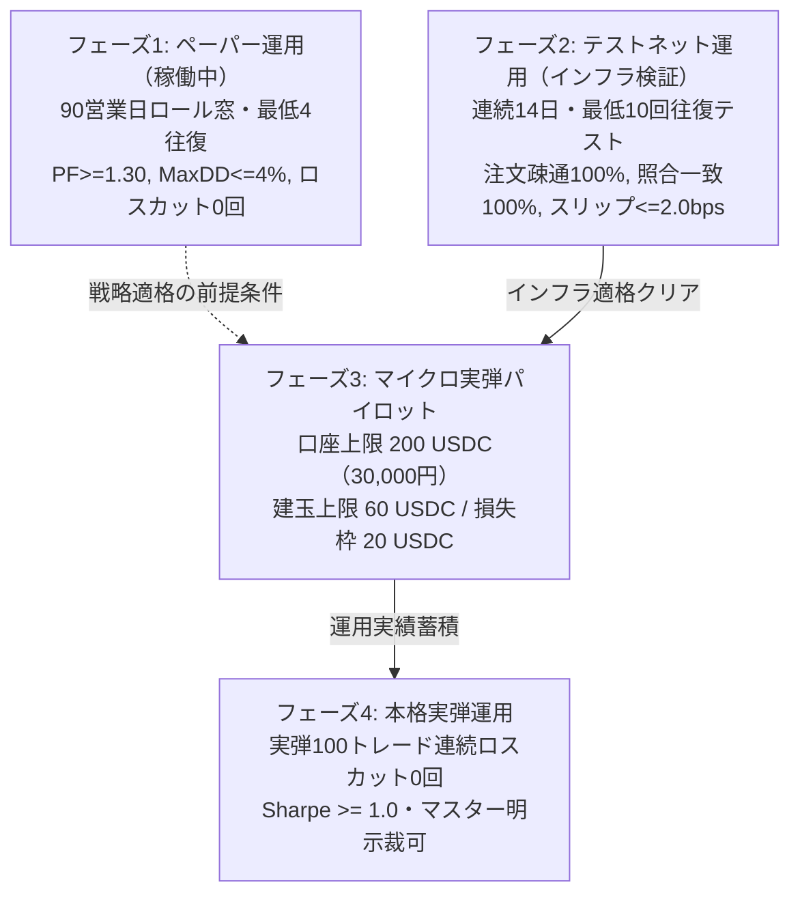

# CIO設計書 — Hyperliquid 実行トラック段取り仕様書（テストネット → マイクロ実弾移行計画）

- 発信者: CIO-Fortuna（投資担当役員）
- 受信者 / 検収担当: CTO-Valkyrie（技術統括役員）
- 承認対象タスク: `t_8affd597`
- 参照基盤:
  - `docs/CIO_FX_LEVERAGE_LANE_DESIGN_20261030.md` rev.2（CTO承認済み・損失定義・3層構造）
  - `docs/CIO_S07_REV1_SPEC_20261030.md`（S-07 rev.1 実装仕様・90日ゲート合格済み）
  - `scripts/s07_paper/hl_client.py`（既存の公開API読み取りクライアント）
- ステータス: **CTO独立検収申請版（発注0件・署名鍵未作成・設計のみ）**

---

## 1. 目的とスコープ

本設計書は、現在ペーパー運用中（起点 2026-10-30）の S-07 rev.1 戦略（BTC無期限パーペチュアル日足トレンド＋Fundingフィルター）について、マスターの承認と鍵配置の後に**「テストネット検証」→「マイクロ実弾パイロット（上限30,000円）」へと安全・不可逆な手順で進めるための「実行トラック」の段取り仕様**を定義する。

### 基本原則
1. **実弾・テストネット発注は現時点で0件、署名鍵も未作成**（本設計書は実装・発注・鍵生成を行わない）。
2. **未検証の数字を断定しない**（すべて公式ドキュメントおよび先行実測ログに基づく）。
3. **有料APIを前提としない**（Hyperliquid の無料L1 APIのみで完結）。
4. **秘密鍵の値はカード・ログ・設計書・画面出力に一切記載しない**。

---

## 2. 実行トラック段取り仕様（8項目詳細）

### 2.1 環境分離と権限設計（Testnet vs Mainnet & エージェント鍵）

1. **エンドポイントURLの物理的分離**:
   - **Mainnet（本番）**:
     - REST API: `https://api.hyperliquid.xyz`（`/info` および `/exchange`）
     - Web UI: `https://app.hyperliquid.xyz`
   - **Testnet（検証環境）**:
     - REST API: `https://api.hyperliquid-testnet.xyz`（`/info` および `/exchange`）
     - Web UI: `https://app.hyperliquid-testnet.xyz`
   - 出典: Hyperliquid API Documentation (https://hyperliquid.gitbook.io/hyperliquid-docs/for-developers/api)

2. **アカウントとAPIウォレット（エージェント鍵）の権限分離**:
   - **マスターEOA（メインウォレット）**: 資金の入出金・保有専用。ブラウザ（MetaMask等）またはコールド環境で管理し、**VPSサーバー上には秘密鍵を一切配置しない（署名もしない）**。
   - **APIウォレット（Agent Wallet）**: 取引実行専用の一時鍵。マスターEOAが取引所プロトコルに対して EIP-712 署名（アクション: `approveAgent`）をブラウザUI上で1回発行して登録する。
   - **出金権限のプロトコル的遮断**: Agent Wallet には `order`（発注）, `cancel`（取消）, `scheduleCancel`（時限取消）, `updateLeverage`（レバレッジ変更）, `updateIsolatedMargin`（分離証拠金変更）の権限のみが付与される。`withdraw`（外部出金）や `usdSend`（内部送金）、新たな `approveAgent`（エージェント追加）の権限はプロトコル仕様上持たない。万一VPSが侵害されても資金外部流出は原理的に不可能である。
   - 出典: Authentication & Agent API (https://hyperliquid.gitbook.io/hyperliquid-docs/for-developers/api/authentication)

3. **テストネット資金前提とマスター作業最小化原則（2026-11-02 前提確定）**:
   - **テスト資金入金済み前提（フォーセット再取得不要）**:
     - マスター申告により、テスト用口座には既に資金が入金済みである。したがって「新規アドレスに$5入金して実績を作る」等の追加出金・入金作業や、API/UI経由でのフォーセット再取得手順は不要である（ただし残高不足時の事前検証・遮断仕様は§2.7に維持）。
   - **エージェント鍵とマスター作業最小化原則**:
     - テスト口座は既存の入金済みアドレスを使用する（マスターの追加入金・振替作業はゼロ）。
     - システム側で該当アドレス向けのエージェント署名鍵を自動生成し、`/root/.secrets/`（chmod 600）に配置する。
     - マスターに求める作業は、ブラウザUI（`app.hyperliquid-testnet.xyz`）上での **エージェントアドレス承認（`approveAgent`）1回のみ** とする。
     - 署名鍵・秘密鍵の値はカード・ログ・設計書・画面出力に一切書かない。
   - **未解決事項（テスト用公開アドレスの受領待ち）**:
     - 現時点でVPS・リポジトリ・`.secrets` 内に該当アドレスの保存は0件である。残高・ポジション・履歴は公開API（`POST /info` の `clearinghouseState`）によりアドレス文字列のみで読取照会可能であるため（秘密鍵不要）、マスターよりテスト用公開アドレス（`0x...`）を1件受領次第、即座に残高照合を実施する。

---

### 2.2 署名方式の選定と依存構造

1. **選定結論**: **公式SDK（`hyperliquid-python-sdk`）のコア署名・クライアント機能を採用**。
   - 出典: Hyperliquid Python SDK GitHub (https://github.com/hyperliquid-dex/hyperliquid-python-sdk)

2. **採用理由（EIP-712 直実装との比較）**:
   - 自前直実装（`eth-account` のみの軽量ラッパー）は依存を極小化できる反面、Hyperliquid 独自の msgpack シリアライズ形式（辞書キーの出現順序やバイナリパッキング規則）の変更時にハッシュ不一致・署名無効（Signature Error）を起こす保守リスクが高い。
   - 公式SDKは取引所仕様の型定義（OrderWire, CancelWire等）および EIP-712 構造化署名（Type Hash / Domain Separator）に完全準拠しており、取引所のアップデートに即時追従可能である。

3. **VPS環境での依存と負荷（実測確認済み）**:
   - 既存の `/root/hyperliquid-venv` において `hyperliquid-python-sdk 0.24.0` および `eth-account 0.13.7` が導入済みであり、正常稼働を確認済み。
   - 実行時負荷: 署名処理は pure Python / Rust拡張の Keccak-256 + secp256k1 署名のみであり、CPU消費はミリ秒級、メモリ負荷は数十MB程度でVPS環境（Linux x86_64）に一切の過負荷を与えない。
   - 責務分担: 注文・署名・口座操作は公式SDKの `Exchange` クラスを薄いラッパー経由で呼び出し、公開相場データの定期取得は既存のゼロ依存 `scripts/s07_paper/hl_client.py`（REST `POST /info`）を維持して障害点を分離する。

---

### 2.3 注文仕様と丸め規則

1. **注文タイプの使い分け**:
   - **新規エントリー / ドテン**: **指値IOC（Limit Order with IOC: Immediate-Or-Cancel）** を採用。
     - 取引所公式成行（Market）はデフォルトで 800 bps（8.0%）のスリッページ許容幅が適用されるため、急変時の滑りリスクがある。
     - したがって、「直近中間価格（Mid Px） $\pm 2.0 \text{ bps}$（許容スリッページ上限）」の指値IOCを発注し、板が薄く即時約定しない数量は自動キャンセルさせる（無理な高値掴み・安値売りを防止）。
   - **手仕舞い（Exit）**: **`reduceOnly: true` の指値IOC（スリッページ許容幅 5.0 bps）** を使用。
     - 意図せぬ逆サイド建玉の新規保有をプロトコルレベルで防止するため、手仕舞い発注時は必ず `reduce_only = True` を指定する。
   - **ストップロス（SL）トリガ**: エントリー約定直後に、取引所側 **Stop-Market トリガ注文（`trigger: {"isMarket": true, "triggerPx": ..., "tpsl": "sl"}`）** を登録。
     - VPSの通信途絶やプロセス停止時でもプロトコルL1上で確実に損切り（$1.8 \times ATR_{14}$）が執行されるバックストップを確保する。
   - 出典: Hyperliquid Order Types (https://hyperliquid.gitbook.io/hyperliquid-docs/trading/orders)

2. **価格・サイズの丸め規則と制約（数値）**:
   - **最小数量刻み（`szDecimals`）**: BTC Perp は **`szDecimals = 5`**（最小単位 $0.00001 \text{ BTC}$、約 $0.78 \sim 0.90 \text{ USDC}$ 相当）。切捨て処理 `math.floor(sz * 1e5) / 1e5` を強制。
   - **最小発注額（Min Notional）**: 全パーペチュアル共通で **$10.0 \text{ USDC}$**。$P \times sz \ge 10.0$ を満たさない発注はローカル事前バリデーションで即時拒否。
   - **価格刻み（Tick Size & 有効桁数・公式丸め契約）**:
     - 取引所公式仕様に厳格準拠: **価格は「有効数字最大 5 桁（$\le 5$ significant figures）」AND「小数点以下最大 $6 - \text{szDecimals}$ 桁」** を同時に満たす必要がある。ただし、**「整数価格（Integer prices）は有効数字の桁数に関係なく常に許可」** される。
     - BTC Perp は $\text{szDecimals} = 5$ のため、小数点以下は最大 $6 - 5 = 1$ 桁まで。
     - **具体例の区別**:
       - **無効例**: `78012.1`（有効数字が 6 桁となり「有効数字最大 5 桁」に違反するため取引所 API で無効 tick として拒否される）。
       - **有効例**: `78012`（整数価格のため有効数字の桁数に関係なく許可）、`78010`（5桁以下整数）、`7801.2`（有効数字 5 桁かつ小数第 1 位のため許可）。
     - 発注前バリデーションにおいて、現在価格が 10,000 以上の銘柄（BTC等）では整数丸め（`round(px)`）または有効数字 5 桁への正規化を強制し、`78012.1` のような無効 tick 指値を物理遮断する。
   - **1注文の上限額**: マイクロ実弾フェーズ3における1注文上限は **60.0 USDC**（約 $0.00077 \text{ BTC}$）。誤発注防止のため、60 USDC を超える発注はローカルバリデーションで即時遮断。
   - 出典: Tick and Lot Size (https://hyperliquid.gitbook.io/hyperliquid-docs/for-developers/api/tick-and-lot-size)

---

### 2.4 リスク制限値とキルスイッチ仕様

1. **数値制限（CTO承認済み `CIO_FX_LEVERAGE_LANE_DESIGN_20261030.md` rev.2 準拠）**:
   - **口座資金（マイクロ実弾）**: **200.0 USDC**（想定為替レート 1 USD = 150 円換算で約 30,000 円）。
   - **1建玉あたりの隔離証拠金**: **20.0 USDC**（口座資金の 10.0%）。
     - 分離証拠金モード（`is_cross: False`）により清算枠を物理隔離。
     - **Auto-Margin（自動証拠金補充）は明示的に禁止（無効化）**。
     - 比率 10.0% の適用場所・基準残高・丸め規約は `docs/HL_EXEC_RISK_MARGIN_CAP_CONTRACT_20261102.md`（2026-11-02 裁定）に確定済み。
   - **設定レバレッジ**: **3.0 倍**（建玉上限 60.0 USDC、口座全体の実効レバレッジは 0.30 倍）。
   - **同時建玉数**: **最大 1 建玉**（S-07 rev.1 は BTC 単一銘柄のみ。同時複数ポジションは禁止）。
   - **日次損失停止（Circuit Breaker）**: 当日累計確定損益が **$-2.0\%$（$-4.0 \text{ USDC}$）** に達した瞬間、全建玉を成行決済し翌日 00:00 UTC まで新規発注をロック。
   - **累積DD停止（Max Drawdown Stop）**: ピークEquityからの下落が **$-4.0\%$（$-8.0 \text{ USDC}$）** に達した時点で全ポジション決済・運用完全停止・設計再審査。
   - **清算までの距離（Liquidation Buffer）**:
     - 設定レバレッジ 3.0 倍・BTC MMR 1.25% 時の清算許容逆行幅は理論値 **$32.49\%$**（出典: `official_liquidations.txt`）。
     - 通常損切り（$1.8 \times ATR_{14}$、約 $5 \sim 6\%$）と十分に乖離。
     - 現在価格から清算価格までの距離が **$15.0\%$** 未満に接近した場合は異常事態として即時成行決済・プロセス終了。
   - **総損失の条件付き管理**: 清算時の損失枠は $(L_{iso} + C_{ext}) \times R_{fx}$（$L_{iso} \le 20 \text{ USDC}$、枠外費用 $C_{ext}$、実換算レート $R_{fx}$）。固定円や法的保証ではなく、為替・枠外費用を含めた動的監視を行う。

2. **キルスイッチ（Kill Switch）と緊急停止契約（Emergency Shutdown Contract）**:
   - **ファイル判定キルスイッチ（最優先ローカル遮断）**:
     - 監視パス: `/root/.secrets/HL_KILL_SWITCH`
     - ファイルが存在（`os.path.exists`）する場合、稼働中の全プロセスが次回ループ・次回発注直前に即座に新規発注を完全停止（ローカルロック）。
   - **コマンド1つでの緊急停止契約（Emergency Shutdown Sequence）**:
     - 実行コマンド: `python3 -m yowayowa.execution.hl_kill --env mainnet`（または `--env testnet`）
     - **厳格な実行シーケンス（Fail-Safe 優先順序）**:
       1. **Step 1: 新規発注禁止の確定（通信前アトミックロック）**: 取引所とのネットワーク通信を行う前に、まずローカルのキルスイッチファイル `/root/.secrets/HL_KILL_SWITCH` をアトミックに作成し、システム全体の新規発注・更新ルーチンを物理遮断する。以降の通信が切断・例外停止した場合でもロック状態は確実に維持される。
       2. **Step 2: 公式取消操作による未約定注文の即時一括取消**:
          - 取引所公式の取消アクション（`cancel` / `cancelByCloid`、複数時は bulk cancel）を実行し、板上の指値注文を即時取消する。
          - ※公式の `scheduleCancel` は「現在時刻から最低5秒後の予約取消（デッドマンズスイッチ）」であり即時取消とは異なるため、緊急停止時の主操作には用いず、通信断絶時の二次バックストップ（保険）としてのみ予約併用する。
       3. **Step 3: 保有建玉の全決済（`reduceOnly: true`）**:
          - ポジションが存在する場合、スリッページ許容幅を広げた `reduceOnly: true` の指値IOCまたは成行注文を発行し、建玉を全決済中立化する。
       4. **Step 4: 注文0件・建玉0件の読取照合（Reconciliation）**:
          - 公開API（`POST /info`）より `openOrders` および `clearinghouseState` を読み取り、**「未約定注文数 == 0」かつ「建玉数量 == 0 BTC」** であることを機械的に照合確認する。
       5. **Step 5: 完了判定と通知分岐**:
          - **全停止完了（Shutdown Complete）**: Step 4 で注文0件・建玉0件が照合確認された場合のみ、「全停止完了」としてログ記録および Telegram 正常終了通知を発報。
          - **停止要求済み／未解決（Shutdown Unresolved）**: Step 2〜4 において通信断絶・API拒否・部分約定・タイムアウト・照合不一致等が発生した場合は、**発注ロック（`/root/.secrets/HL_KILL_SWITCH`）を恒久維持したまま「全停止未解決・要手動介入（Shutdown Unresolved）」** として管理者へ緊急アラートを発報。結果不明のまま「全停止完了」とみなすことは厳格に禁止する。
   - 出典:
     - Exchange Endpoint (Cancel / Schedule cancel): https://hyperliquid.gitbook.io/hyperliquid-docs/for-developers/api/exchange-endpoint
     - Info Endpoint (openOrders): https://hyperliquid.gitbook.io/hyperliquid-docs/for-developers/api/info-endpoint
     - Perpetuals Clearinghouse State: https://hyperliquid.gitbook.io/hyperliquid-docs/for-developers/api/info-endpoint/perpetuals

---

### 2.5 記録・照合・日次サマリ仕様

1. **発注前の意図（三段ログ）**:
   - `SIGNAL` ログ: 戦略ロジック（`s07_strategy.py`）の判定（時刻、確定足OHLCV、SMA50、EMA10/20、ATR14、判定結果: BUY / SELL / EXIT / HOLD、推奨数量）。
   - `INTENT` ログ: リスクフィルター・ロット丸め・残高検証後の発注意図（銘柄、サイド、数量、指値IOC価格、SLトリガ価格、隔離証拠金割当額、Client Order ID: `cloid`）。
   - `ORDER` ログ: 取引所APIへの送信電文（payload JSON、署名タイムスタンプ）およびAPI応答（status、fills/resting/error、txHash）。
   - 保存先: `data/execution_logs/hl_{env}_{YYYYMMDD}.jsonl`（改ざん不能な追記専用ログ）。

2. **約定後の照合（Reconciliation）**:
   - 発注直後および定期（毎正時・日足確定後）に `POST /info` の `clearinghouseState`（口座残高、分離証拠金、建玉数量 `size`、建値 `entryPx`）および `userFills` を取得。
   - ローカルの内部ステート（`state_{env}.json`）の `position_size` と取引所実ポジションを完全突合。
   - **ポジション乖離（Discrepancy）検出時**: 数量差分が $\ge 0.00001 \text{ BTC}$ の場合、即座に発注ロック（State Mismatch Error）をかけ、Telegram 通知。

3. **日次サマリ（Daily Summary）**:
   - 毎日 00:05 UTC（日足確定・約定照合完了後）に自動生成。
   - 出力内容: 当日確定損益（Realized PnL）、含み損益（Unrealized PnL）、往復手数料（Fees）、Funding受払額（Funding PnL）、口座総資産（Equity）、現在建玉状況、照合ステータス（Reconciliation OK/NG）。
   - 格納先: `data/reports/s07_daily_summary_{YYYYMMDD}.md`。

---

### 2.6 段階的ゲート移行基準（紙 → テストネット → マイクロ実弾）

各段階の合格条件を数値で明確に定義する。飛び級は一切認めない。

1. **フェーズ1: ペーパー運用（紙ゲート・S-07 rev.1 稼働中）**:
   - 判定窓: **90営業日ロール窓** かつ **最低4往復**。
   - 合格基準: 完遂率 $\ge 98.0\%$、MaxDD $\le 4.0\%$、$EV > 0$ かつ $PF \ge 1.30$、月間反転 $\le 6.0$ 回、発注容量例外 0 件、**強制ロスカット 0 回**。
   - 出典: `docs/CIO_FX_LEVERAGE_LANE_DESIGN_20261030.md` §6.1。

2. **フェーズ2: テストネット運用（インフラ・発注疎通ゲート）**:
   - 期間: **連続14営業日** かつ **最低10回の発注・約定・取消・SLトリガ往復テスト**。
   - 合格基準（数値）:
     - 注文疎通・約定成功率: **$100.0\%$**（APIタイムアウト・未処理拒否 0件）
     - ステート照合一致率: **$100.0\%$**（ローカル記録と `clearinghouseState` の差分 0件）
     - 実効スリッページ: **$\le 2.0 \text{ bps}$**（95%信頼上限）
     - キルスイッチ実動検証: **1回以上テストネット上で正常発動・全未約定取消・全決済確認**
     - 意図せぬ清算・残高不足例外: **0回**

3. **フェーズ3: マイクロ実弾パイロット（実資金 200 USDC・30,000円）**:
   - 資金上限: **200 USDC（約30,000円）**、建玉上限 **60 USDC**、清算損失枠 **20 USDC**。
   - 本格実弾（フェーズ4）への昇格基準: 実弾 **100トレード連続ロスカット0件** かつ 実効 **Sharpe Ratio $\ge 1.0$**。

4. **S-07 90営業日ゲートとの関係（明確な依存性）**:
   - **先行検証の並行実施**: テストネットでのインフラ・署名・キルスイッチ疎通検証（14日間）は、S-07 rev.1 の90営業日ペーパー運用の期間中に「先行して」進めることができる。
   - **実弾移行の絶対ゲート**: ただし、テストネットに合格したとしても、**S-07 rev.1 の90営業日ペーパーゲート（戦略適格: 90日経過・最低4往復・PF $\ge 1.30$・MaxDD $\le 4\%$・清算0回）を正式クリアし、マスターの明示裁可を受けるまでは、マイクロ実弾（メインネット）へ絶対に移行しない**。

---

### 2.7 障害・異常系の処理方針

1. **部分約定（Partial Fill）**:
   - 指値IOCのため、未約定残数量は取引所側で即時自動キャンセルされる。
   - 処理: `userFills` を照会して約定数量を正確に取得し、内部ステートの建玉数量を更新。残数量が最小発注額（$10 \text{ USDC}$）未満となった場合は無理な追加発注を行わず、そのポジション量で維持。次回足で手仕舞い。**自動リトライ禁止**。

2. **通信切断・タイムアウト（Network Drop / Timeout）**:
   - **自動再発注の完全禁止**: 注文送信後にタイムアウトが発生した場合、即座に同一注文を再発注してはならない（取引所側で約定していた場合に多重発注となり過剰ポジションを建てる重大リスクがあるため）。
   - 処理: まず `POST /info` で `openOrders` および `userFills` を取得し、当該注文（`cloid` 照合）が成立しているかを確認。
     - 約定済みの場合はステート更新。
     - 未成立かつ注文も存在しない場合のみ、1回だけ再試行。

3. **取引所拒否（Order Rejection, e.g., Invalid Price/Size/Margin）**:
   - 取引所からエラー応答（例: `Order rejected: Insufficient margin`, `Invalid tick` 等）が返った場合、**自動リトライは完全禁止**。
   - 処理: エラー内容を `ORDER` ログに記録し、当日発注を即時停止。管理者に Telegram アラート発報。

4. **残高不足（Insufficient Margin）**:
   - 発注前のローカル事前チェック（Pre-flight Check）で、`clearinghouseState.withdrawable`（または余剰マージン）が要求分離証拠金（20 USDC）＋手数料バッファ（5 USDC）を満たしているかを検証。
   - 不足している場合は発注処理をバイパス（スキップ）し、`WARNING` ログ記録＆Telegram 通知。**自動リトライ禁止**。

---

### 2.8 秘密情報管理とセキュリティ規律

1. **配置パス**:
   - テストネットエージェント秘密鍵: `/root/.secrets/hl_agent_testnet.key`
   - メインネットエージェント秘密鍵: `/root/.secrets/hl_agent_mainnet.key`

2. **パーミッション**:
   - 所有者: `root:root`
   - 権限: **`chmod 600`**（他ユーザー読み書き禁止）

3. **秘密保持規律（不可視化）**:
   - **カード、コミット、PR、実行ログ、画面出力、Telegram 通知のいずれにも秘密鍵の値（HEX文字列・ニーモニック）を絶対に記載・出力しない**。
   - 環境変数の `env` コマンド dump、例外スタックトレース時にも秘密鍵変数を伏字化（`***REDACTED***`）するマスキング処理を実装。
   - メインウォレットの秘密鍵はサーバー上に一切配置せず、マスターの手元（ハードウェアウォレット / MetaMask）にのみ留める。

---

## 3. 出典公式ドキュメント一覧

- [1] Hyperliquid API Overview: https://hyperliquid.gitbook.io/hyperliquid-docs/for-developers/api
- [2] Info Endpoint: https://hyperliquid.gitbook.io/hyperliquid-docs/for-developers/api/info-endpoint
- [3] Exchange Endpoint: https://hyperliquid.gitbook.io/hyperliquid-docs/for-developers/api/exchange-endpoint
- [4] Authentication (Agent API): https://hyperliquid.gitbook.io/hyperliquid-docs/for-developers/api/authentication
- [5] Order Types: https://hyperliquid.gitbook.io/hyperliquid-docs/trading/orders
- [6] Tick and Lot Size: https://hyperliquid.gitbook.io/hyperliquid-docs/for-developers/api/tick-and-lot-size
- [7] Margining & Leverage: https://hyperliquid.gitbook.io/hyperliquid-docs/trading/margining
- [8] Liquidations: https://hyperliquid.gitbook.io/hyperliquid-docs/trading/liquidations
- [9] Hyperliquid Python SDK: https://github.com/hyperliquid-dex/hyperliquid-python-sdk
