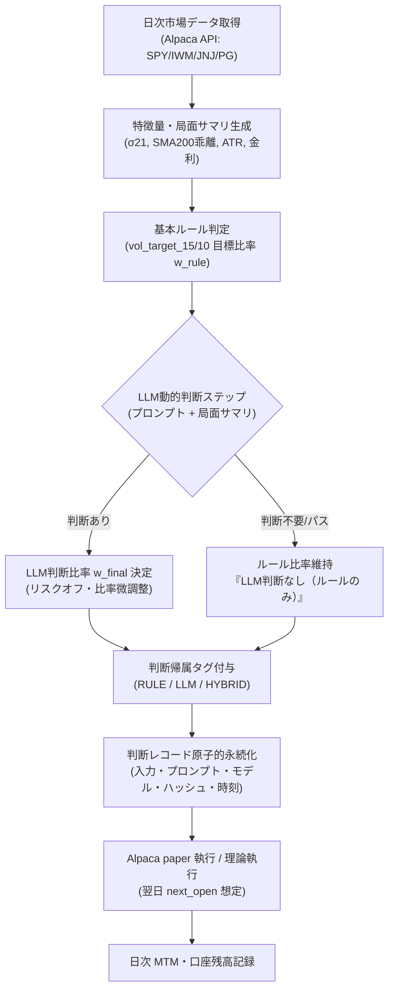
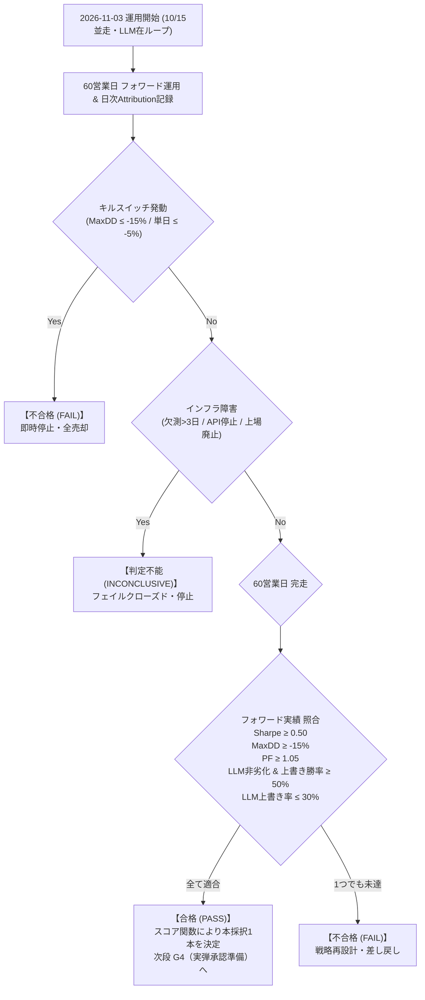

# G2設計書: C2（S-02 vol_target_15 / 10並走）LLM在ループ・フォワードペーパー運用フェーズ設計

- **作成日**: 2026-11-02
- **タスクID**: `t_b342f09b`
- **設計責任**: `cio-fortuna`（CIO）
- **監督最優先指示反映**: 2026-11-02 16:44（Muse 指示: 重心の修正・フォワード実績至上主義・LLM在ループ・判断帰属 attribution の完全組込み）
- **レビュー判定反映**: 2026-11-02 16:48（`cto-hephaestus` 変更要求 round 1 の完全反映）
- **基本原則**: 実弾 0・入出金 0・本番接続 0・コード変更 0（本カードは設計確定のみ、実装は別カード）
- **戦略スコープ制約**: 
  - 対象戦略: **C2（S-02 vol_target_15 / 10 並走）**
  - **S-03 は除外**（未承認のため本カードの対象外）
  - **S-05 は持越し**（統計ゲート `t_d8eb7d58` の結果を親として参照し、本カードでは扱わない）

---

## 1. 基本方針と大前提（バックテストの限界とフォワード至上主義）

### 1.1 バックテストは「指針」であり合格証ではない
本フェーズ（G2）における最重要原則は、**「バックテストは指針であり、合格証ではない。G2 の合否はフォワードの生きた時間で実際に生み出された実績のみで決める」** という点にある。

### 1.2 なぜバックテストを合格証にしないか（汚染と過学習の前提明記）
LLM の動的判断が介在するシステムにおいて、バックテスト（過去データでの検証）を合格証としてはならない構造的理由は以下の通りである。

1. **事前学習データによる時系列記憶の汚染（Data Leakage / Memorization）**:
   - LLM は過去の大規模な市場データやニュース、歴史的出来事（2022年の急激利上げや2024年のハイテク急落等）を学習データとして内部に記憶している。
   - バックテストで「過去の相場を正しく判断できた」としても、それはモデルが過去の正解を記憶していただけの「後出しジャンケン」である可能性を排除できない。
   - 実際、**モデルの学習カットオフを跨いだ途端に Sharpe 比が概ね 5 割蒸発する** という実測報告が多数存在する。
2. **統計的過学習（PBO）の現実**:
   - 統計ゲート `t_d8eb7d58` において、C2（`s02_vol_target_15`）の PBO（Probability of Backtest Overfitting）が **0.9068（90.68%）** と極めて高く算出された。パラメータ「15%」の選定自体が過去窓への適合である懸念が残る。
3. **結論**:
   - 過去窓の追跡相関やバックテスト再現性を合否条件に据えることは無意味であるのみならず有害である。
   - **G2 ゲートの合否は、未知の未来環境において「LLM を実際にループに組み込み、日次で判断・執行させたフォワード実績」のみをもって機械的に判定する。**

---

## 2. 会場および実装経路の選定（3案比較と推奨案の決定）

フォワード・ペーパー運用の会場および実装経路について、以下の 3 案を比較検討する。

### 2.1 3 案の比較評価

| 評価軸 | 案A: paperloop 拡張（内部理論執行） | 案B: Alpaca paper API（推奨） | 案C: Hyperliquid テストネット（不適） |
|---|---|---|---|
| **概要** | 既存の paperloop ランナーに C2 の日次シグナルを載せ、理論損益を記録。発注 0。 | Alpaca paper API へ接続し、フォワードペーパー発注を実行。約定・スリッページを実測。 | HIP-3 株式 DEX または crypto パーペチュアル環境へ C2 ロジックを接続。 |
| **測れるもの** | ・シグナル生成パイプラインの安定性 ・理論 MTM 損益推移 ・LLM 判断ログの完全性 | ・リアルな約定タイムスタンプとスリッページ ・手数料控除後のキャッシュ残高推移 ・API レート制限・認証挙動・残高同期 | ・L1 オンチェーン板での約定挙動 ・DEX マージン・資金調達（Funding）管理 |
| **測れないもの** | ・実市場のスプレッド・スリッページ ・注文執行レイテンシとブローカー障害 ・残高整合性のリアルタイムドリフト | ・実弾固有のマーケットインパクト（※ただし流動性 ETF/大型株のためペーパー約定で十分代替可能） | ・米国現物株式市場の流動性・取引時間特性 ・配当落ち（TR）と米ドル現金利回り（DGS1） |
| **実装コスト** | **極小**: 既存 paperloop ランナーに C2 設定とシグナル計算関数を追加するのみ。 | **中**: `t_cb6f2dd0` で Alpaca paper 認証・疎通確認完了済み。LLM ループと結合。 | **高**: `hl_exec` は暗号資産デリバティブ向けであり、株式 ETF ポートフォリオには構造不適。 |
| **本番移行時の接続性** | **低**: ブローカー発注・約定・残高同期基盤が未検証のまま残り、本番移行時に新規実装が必要。 | **極高**: API エンドポイントとキーを paper から live へ切り替えるだけで本番発注へ移行可能。 | **不可**: 株式 C2 を暗号資産 DEX で本番運用する道筋は未確立（流動性・規制非適合）。 |

### 2.2 推奨案の決定と理由

- **決定**: **案B（Alpaca paper API）を採用する**。
- **採択理由**:
  1. **実弾 0 の完全担保**: Alpaca paper 環境は実資金の入出金を一切伴わず、完全な模擬資金で動作するため、実弾リスクがゼロである。
  2. **実測精度の優位性**: 案A（内部計算のみ）では測れないリアルなスリッページ・スプレッド・API 接続安定性を 60 営業日にわたり実測可能である。
  3. **本番接続性**: `t_cb6f2dd0` で認証実測が完了しており、将来の本番移行（G5）時にもコードの再利用性が極めて高い。
- **案C（Hyperliquid）の不適理由**: HIP-3 株式 DEX は流動性が未検証であり、板が極めて薄くスプレッド異常の懸念がある。また C2 の本質である米国株式 ETF（SPY/IWM/JNJ/PG）の現物保有および配当トータルリターン（TR）の検証には適合しないため、比較表に残した上で明確に不採用とする。

---

## 3. LLM在ループ・フォワードペーパー運用の設計

### 3.1 日次実行パイプラインのアーキテクチャ
日次で以下の閉ループをスケジュール実行（cron / timer）する。実弾発注は行わず、Alpaca paper API への模擬発注および理論執行（実弾 0）を徹底する。

### 3.2 LLM 判断レコードの完全性保証（再現性の担保）
判断が発生した日も、発生しなかった日も、以下の全コンテキストを 1 レコードに原子的（JSONL 追記）に記録する。後から第三者が 1 ビットの狂いもなく推論を再現できる粒度を担保する。

- **必須固定フィールド**:
  - `decision_id`: `{candidate}:{target_vol}:{date}:{seq}`（主キー）
  - `timestamp_utc`: 推論実行の正確な ISO 8601 時刻
  - `inputs`:
    - `spy_close`, `spy_sma200`, `spy_sigma21_annualized`, `dgs1_rate`
    - 各構成銘柄の終値・前日比
  - `rule_output`: 基本ルールが算出した目標比率 $w_{\text{rule}}$（各銘柄 $w_{\text{rule}}/4$）
  - `llm_decision`:
    - `called`: `true` / `false`
    - `model`: 使用モデル識別子（例: `claude-3-5-sonnet-20241022`, `gemini-1.5-pro` 等）
    - `prompt_template_sha256`: 使用プロンプトの完全ハッシュ
    - `prompt_input_summary`: LLM に渡した局面サマリテキスト
    - `raw_response`: LLM の返答全文
    - `parsed_intent`: LLM が意図した介入（例: `HOLD_RULE`, `REDUCE_EXPOSURE_20PCT`, `EMERGENCY_CASH` 等）
    - `reasoning`: 判断の言語的根拠
  - `final_weights`: 最終適用重み $w_{\text{final}}$
  - `attribution_label`: `RULE` / `LLM` / `HYBRID`（次節参照）
  - `prev_line_sha256`: 改ざん防止ハッシュチェーン

> [!NOTE]
> LLM の介入を行わない日（通常の週次ホールド日や、ルール通りで問題ないと判定された日）は、`attribution_label: "RULE"`、`llm_decision.called: false`（または `parsed_intent: "HOLD_RULE"`）として**「LLM判断なし（ルールのみ）」を明示的に記録**する。

---

## 4. 判断の帰属記録（attribution）— G2 の中核成果物

G2 ペーパー運用の最重要成果物は、**「この利益（または損失）は、ルールによるものか、LLM の介入によるものか」** を 1 判断単位で完全に分離・証明する帰属台帳である。

### 4.1 3 値ラベルの定義
すべての意思決定に以下の 3 値ラベルを厳密に付与する:
1. **`RULE`（ルール由来）**:
   - LLM が介在せず、基本ロジック（目標ボラティリティ 15% / 10% の週次計算式）の出力がそのまま 100% 適用された判断。
2. **`LLM`（LLM 判断由来）**:
   - ルールが算出した比率を、LLM が独自の定性判断（マクロショック警戒、ボラ急変予兆など）によって明示的に上書き（Override）した判断（例: ルール $w=0.8$ に対し LLM が「警戒」として $w=0.4$ へ強制削減）。
3. **`HYBRID`（併用）**:
   - ルールが算出した比率の枠組み内で、LLM が微調整（$\pm 10\%$ 以内のリスク微調整や銘柄間の傾斜配分）を適用した判断。

### 4.2 結果突合（Outcome Join）の仕様
日々の運用が進むごとに、過去の判断レコード `decision_id` に対して、その後の実測結果を**判断 ID で結合（JOIN）**する。

- **結合する測定窓**:
  - `1d_fwd_return`: 判断翌営業日のリターン（寄付き〜引け）
  - `5d_fwd_return`: 判断後 5 営業日（次回リバランスまで）の累積リターン
  - `dd_contribution`: その判断期間中に発生した最大ドローダウンへの寄与度（%pt）
  - `rule_counterfactual_return`: **「もし LLM が上書きせず、ルールのまま執行していたらどうなっていたか」** の反事実（Counterfactual）リターン

### 4.3 由来別集計表（Attribution Summary Matrix）の出力仕様
60 営業日終了時に、以下の集計表を自動生成し、成果物レポートとして確定する。

| 由来ラベル | 判断件数 | 全体比率 | 平均 5d リターン | 勝率 (5d > 0) | 実効 Sharpe | 累積リターン寄与 | MaxDD 寄与 |
|---|---:|---:|---:|---:|---:|---:|---:|
| **`RULE`（ルール単独）** | $N_{\text{rule}}$ | $P_{\text{rule}}\%$ | $\mu_{\text{rule}}$ | $\text{WR}_{\text{rule}}$ | $\text{SR}_{\text{rule}}$ | $\sum R_{\text{rule}}$ | $\text{DD}_{\text{rule}}$ |
| **`LLM`（LLM 上書き）** | $N_{\text{llm}}$ | $P_{\text{llm}}\%$ | $\mu_{\text{llm}}$ | $\text{WR}_{\text{llm}}$ | $\text{SR}_{\text{llm}}$ | $\sum R_{\text{llm}}$ | $\text{DD}_{\text{llm}}$ |
| **`HYBRID`（併用微調整）**| $N_{\text{hyb}}$ | $P_{\text{hyb}}\%$ | $\mu_{\text{hyb}}$ | $\text{WR}_{\text{hyb}}$ | $\text{SR}_{\text{hyb}}$ | $\sum R_{\text{hyb}}$ | $\text{DD}_{\text{hyb}}$ |
| **全体合計** | **全60日** | **100.0%** | **$\mu_{\text{total}}$** | **$\text{WR}_{\text{total}}$** | **$\text{SR}_{\text{total}}$**| **$R_{\text{total}}$** | **$\text{MaxDD}_{\text{total}}$** |

#### LLM 上書き分析表（LLM Overwrite Assessment）
LLM がルールを上書きした全件について、「上書きして正解だったか（良し悪し）」を集計する。
- **上書き件数**: $N_{\text{llm}}$ 件（全判断の何%か）
- **上書きアルファ（差分）**: $\text{Actual Return (LLM)} - \text{Counterfactual Return (RULE)}$
- **上書き成功率**: 上書きアルファ $> 0$ の割合（$\ge 50.0\%$ 必須）
- **回避されたドローダウン**: ルールを上書きしたことで防いだ最大下落幅（pt）

---

## 5. 10% と 15% のフォワード並走設計（Parallel Paper Run）

### 5.1 並走の目的
10% と 15% のどちらを最終採択するかは、**バックテストの Sharpe 差（0.92 vs 0.86）ではなく、フォワードの生きた時間における同一条件比較**によって決定する。
並走期間中の割当資金は **0（両者ともに理論執行 / Alpaca paper 口座内でのシミュレーション）** とする。

### 5.2 比較測定と最終採択スコアリング関数
同一の入力データ・同一の LLM 判断コンテキスト下で、`vol_target_10` と `vol_target_15` の 2 系列を日次で並行計算・記録する。
60 営業日終了時に、両者がともに合格条件を満たした場合、以下の**フォワード実測スコア関数**によって機械的に 1 本に絞り込む（事後変更禁止）。

$$\text{Forward Score} = 0.40 \times \frac{\text{Sharpe}_{\text{fwd}}}{0.80} + 0.30 \times \left(1 - \frac{|\text{MaxDD}_{\text{fwd}}|}{0.15}\right) + 0.30 \times \frac{\text{CAGR}_{\text{fwd}}}{0.08} - 0.10 \times \frac{\text{Turnover}_{\text{fwd}}}{3.00}$$

- **採択ルール**:
  - $\text{Forward Score}$ が高い方を、実弾承認ゲート（G4）へ推挙する正候補とする。
  - バックテスト由来の例外規則（スリッページ閾値による固定等）は全廃し、前向きの実測スコアのみで判定する。

---

## 6. 運用期間の確定（検算済み保持値）

事前凍結の原則に従い、期間・起算日・判定日を以下の通り一意に確定する（CTO レビューにてカレンダー検算済み・一致確認済み）。

### 6.1 期間・起算日・判定日の一覧

| 項目 | 確定値 | 決定根拠 |
|---|---|---|
| **対象営業日数** | **60 営業日** | 約 12 週間（12 回のリバランス機会と 1 四半期決算サイクルを網羅）。`LIVE_GATES_G1_G5_DESIGN.md` §3 と完全整合。 |
| **起算日** | **2026-11-03（火）** | 設計凍結日（2026-11-02）の**翌営業日**。遡及的チェリーピッキングを完全排除（米国市場通常営業日）。 |
| **最終営業日** | **2027-01-29（金）** | 2026-11-03 起算、米国市場休場日 4 日（2026-11-26 Thanksgiving, 2026-12-25 Christmas, 2027-01-01 New Year, 2027-01-18 MLK Day）を除いた厳密な第 60 営業日。 |
| **判定日** | **2027-02-01（月）** | 第 60 営業日完了直後の翌週初営業日。バッチ処理完了後に判定書を出力。 |
| **（参考: 第2マイルストーン）**| **90 営業日**（2027-03-15 完了、2027-03-16 判定） | S-07 rev.1（90営業日）と平仄を合わせた中長期継続追跡枠。G2 合否の公式判定は **60 営業日** で確定する。 |

### 6.2 データ欠測・API障害時の厳格な扱い
1. **欠測日非算入**:
   - データ取得失敗、Alpaca API ダウン、通信障害等により日次バーまたは口座データが取得できなかった営業日は、**その日のリターン計算から除外し、判定営業日カウント（60日）に算入しない**（その分判定日は後方へスライドする）。
2. **欠測率上限**:
   - 全 60 営業日中、**欠測営業日は累計 3 営業日以内（欠測率 ≤ 5.0%）** とする。
   - 連続 2 営業日を超える欠測、または累計 4 営業日以上の欠測が発生した場合は、インフラ欠陥とみなし即座に **【判定不能（INCONCLUSIVE）】** とする。
3. **リバランス日（月曜）の欠測**:
   - 週次シグナル計算・発注日（月曜）の欠測は全期間で **最大 1 回** まで許容（火曜寄り付きで代替執行）。2 回以上発生した場合は **【判定不能】** とする。

---

## 7. 合格条件（フォワード実績ベース・事前凍結）

バックテスト指標との一致度や相関を廃止し、**フォワード実測データのみに基づく合格基準** を以下の通り固定する（事後変更禁止）。

### 7.1 フォワード実績合格判定条件（全 7 項目）

| 番号 | 判定項目 | 凍結合格閾値 | 判定根拠・目的 |
|:---:|---|:---:|---|
| **①** | **フォワード実測 Sharpe** | **$\ge 0.50$** | フォワードの生きた時間で、株式市場長期平均水準（0.4〜0.5）以上のリスク調整後リターンを実証すること。 |
| **②** | **フォワード実測 MaxDD** | **$\ge -15.00\%$** （下落幅 $\le 15.00\%$） | フォワード期間中、資産の最大下落幅が 15% 以内に収まっていること（最悪窓耐性）。 |
| **③** | **フォワード実測 Profit Factor** | **$\ge 1.05$** | スリッページ・取引コスト控除後の実測値で、総利益が総損失を上回りプラスの期待値（EV > 0）を維持していること。 |
| **④** | **LLM 由来の非劣化条件 (Attribution Non-Degradation)** | **$\text{Sharpe}_{\text{LLM/HYB}} \ge \text{Sharpe}_{\text{RULE}} - 0.10$ かつ 上書き勝率 $\ge 50.0\%$** | LLM がルールを上書きした判断群が、純粋ルール単独群に対して有意に劣後せず、上書き成功率が 5 割以上であること（LLM 介入の正当性証明）。 |
| **⑤** | **LLM 上書き率上限 (Overwrite Cap)** | **$\le 30.0\%$** （全判断中） | LLM によるルール上書きが全体の 30% 以内に収まっていること（ルールを逸脱した過剰裁量・暴走の防止）。 |
| **⑥** | **運用インフラ完走（欠測率）** | **$\le 5.0\%$** （欠測 $\le 3$ 営業日） | 60 営業日中、外部障害等による欠測が累計 3 日以内、リバランス日欠測が 1 回以内であること。 |
| **⑦** | **キルスイッチ非発動** | **0 回** | 運用期間中に後述の緊急停止キルスイッチが 1 度も発動していないこと。 |

### 7.2 運用上のキルスイッチ（緊急停止条件）
以下のいずれかを検知した場合、即座に全ポジションを成行売却して現金化し、運用を停止する:
1. **資産 DD 上限キル**: ポートフォリオ資産（Equity）が期間中の最高値から **$-15.00\%$** に達した場合（**即時不合格判定**）。
2. **単日異常急落キル**: 日次損失が **$-5.00\%$** を超えた場合（5-sigma 異常検知、当日取引停止・緊急点検）。
3. **連続通信障害キル**: Alpaca API 通信エラーが **連続 3 営業日** 継続した場合（**判定不能フラグ**）。

---

## 8. 判定ルール（3値の明確化）

判定は「合格／不合格／判定不能」の 3 値とし、人の解釈や裁量を排して機械的に確定する。

### 8.1 合格 (PASS)
- 60 営業日を完走し、欠測条件（≤ 3日）を満たした上で、§7.1 の全 7 項目を**すべて同時に満たした場合**。
- 並走する 10% と 15% のうち合格基準を満たした候補から、§5.2 のフォワード実測スコア関数に基づき実弾検討（G4）への推挙 1 本を確定する。

### 8.2 不合格 (FAIL)
- 60 営業日完走後、両候補ともに §7.1 の数値基準を満たせなかった場合。
- または、運用期間中にキルスイッチ（資産 DD -15.00% 到達等）が発動した場合。

### 8.3 判定不能 (INCONCLUSIVE / UNTESTABLE)
以下の不可抗力・外的要因が発生した場合、戦略の真偽を判断できないため「合格」とは扱わず、機械的に【判定不能（FAIL-CLOSED）】として運用を中断・無効化する。
1. **欠測日数超過**: 累計欠測営業日が 4 営業日以上（欠測率 > 5.0%）、または連続 3 営業日以上となった場合。
2. **リバランス日欠測超過**: 月曜リバランス日の欠測が累計 2 回以上発生した場合。
3. **ブローカー API 停止・口座凍結**: Alpaca 側の paper API サービス終了、認証仕様の破壊的変更、またはアカウント凍結により取引不能となった場合。
4. **対象銘柄の異常事象**: `SPY`, `IWM`, `JNJ`, `PG` のいずれかが株式併合、分割比率取得不能、上場廃止、または長期売買停止に陥った場合。
5. **市場全体の停止**: 米国株式市場全体が連続して閉鎖（非常事態・サーキットブレーカー等）された場合。

> [!CAUTION]
> 判定不能となった場合、「不合格ではないから通す」という判断は行わない（FAIL-CLOSED）。原因を解消した上で、新たな起算日から 60 営業日を数え直す。

---

## 9. 後続実装カードへの引き継ぎ事項

本設計書に基づき、実装担当（worker-go 等）は以下の要件を満たす実装カードを起票・実行する（本設計カードではコード変更なし）。

1. **LLM在ループ日次ランナー実装**:
   - `scripts/paper_c2/` 配下に C2 専用ランナーを新規実装。
   - 週次/日次で Alpaca からデータを取得し、特徴量・局面サマリを生成。
   - LLM 推論クライアントを呼び出し、プロンプト・モデル・入出力を保持した上で判断レコードを JSONL に原子的追記。
   - 10% と 15% の 2 系列を並行計算。
2. **判断帰属（Attribution）結合モジュール**:
   - 過去の `decision_id` と日次実績リターンを自動結合し、日次で Attribution Summary Matrix を更新するバッチ処理。
3. **Alpaca paper API 執行と MTM**:
   - 週次リバランス発注（成行/指値スリッページガード）、日次 MTM 口座残高の追跡。
4. **cron スケジューラ配線**:
   - Hermes `no_agent` cron にて、日次バッチ（市場引け後のデータ収集・MTM・Attribution結合）および週次バッチ（月曜寄り前のシグナル生成・LLM推論・発注）を設定。

---

## 10. 付録: 衛生管理・説明責任台帳（※合否判定には一切使用しない）

> [!NOTE]
> 本節（付録A〜E）に記載のバックテスト分析、レジーム分析、Walk-Forward、Turnover、および原典突合結果は、**開発経緯の透明性と説明責任（衛生管理）のために記録するものであり、G2 ペーパー運用の合否判定基準としては一切使用しない**。

### 付録A. 数値の原典突合（MaxDD 差異の解明記録）
- **原典ファイル**: `docs/G1_GATE_20261102.md` および `/root/.hermes/kanban/boards/yowayowa/attachments/t_c707cb4c/s02_new.json`（SHA256: `b78bafce00025c771f0025f173ce1fa46e88e28e43c67518306872ae62bae423`）
- **差異の解明**:
  - **`−14.33%`** は **full 全期間窓（2021-01-04〜2026-09-28、1,440セッション）の MaxDD**（DGS1金利計上後。金利前は −14.68%）。
  - **`−10.23%`** は **OOS 窓（2025-02-07〜2026-09-28、411セッション）の MaxDD**（DGS1金利計上後。金利前は −10.28%）。
- **結論**: 矛盾ではなく評価期間窓の相違および金利加算有無の違いであることを原典実測値と突合して確認済み。

### 付録B. レジーム定義と IS/OOS 逆転要因
- **IS（Sharpe 0.61） vs OOS（Sharpe 1.34）の逆転要因**:
  - IS 期間（2021〜2024）は 2022 年の歴史的利上げに伴う株債同時下落と高ボラ相場を含み、現金も低金利であったため低迷した。
  - OOS 期間（2025〜2026）は一貫した強気相場（SPY最高値更新）と低ボラティリティ環境が持続し、目標 15% の高エクスポージャーが維持され、滞留現金に FRED DGS1（4〜5%）が付与されたため数字が跳ね上がった。
- **レジーム判定式**:
  - トレンド: SPY $\ge$ SMA200（BULL） / SPY $<$ SMA200（BEAR）
  - ボラティリティ: $\sigma_{21}(\text{SPY}) \times \sqrt{252} \le 15.0\%$（LOW_VOL） / $> 15.0\%$（HIGH_VOL）
  - 4 象限マトリクス（Bull/LowVol, Bull/HighVol, Bear/HighVol, Bear/LowVol）を日次記録する。

### 付録C. Rolling Walk-Forward 仕様（参考）
- 窓長 126 営業日（約6ヶ月）、ステップ幅 63 営業日（約3ヶ月）。窓ごとの Sharpe, MaxDD, レジーム滞在日数を参考追跡する。

### 付録D. Turnover 実測値（参考）
- `s02_vol_target_15`: full 年率 Turnover **2.03x**、OOS 年率 Turnover **2.58x**、平均保有日数 約 25〜30 営業日。
- `s02_vol_target_10`: full 年率 Turnover **3.40x**、OOS 年率 Turnover **4.22x**、平均保有日数 約 15〜20 営業日。

### 付録E. コスト2倍感応度分析（参考）
- 基準コスト（片道 15bps）からコスト 2 倍（片道 30bps）へのストレステスト時:
  - 15%: full CAGR $9.18\% \to 8.57\%$（−0.61%pt）、Sharpe $0.86 \to 0.80$、PF $1.151 \to 1.118$。
  - 10%: full CAGR $7.92\% \to 6.90\%$（−1.02%pt）、Sharpe $0.92 \to 0.80$、PF $1.164 \to 1.109$。
  - 15% は Turnover が低いためコスト劣化耐性が高いことを確認済み。

---

## 11. 署名とレビュー確認欄

- **起草者**: `cio-fortuna`（CIO）/ 2026-11-02
- **独立査定者**: `cto-hephaestus`（CTO）
- **レビュー確認事項**:
  - [x] 会場と実装経路の案（案A: paperloop / 案B: Alpaca paper / 案C: Hyperliquid）の比較と推奨決定
  - [x] バックテスト非合格証の原則とフォワード実績至上主義の明記（時系列記憶汚染・Sharpe半減リスク）
  - [x] LLM在ループ・日次実行パイプラインおよび推論コンテキスト完全固定（プロンプト/モデル/時刻/入力）
  - [x] 判断帰属（attribution: RULE / LLM / HYBRID）の定義と判断ID結合集計表仕様
  - [x] フォワード実績ベース合格条件（Sharpe≥0.50, MaxDD≥-15%, PF≥1.05, LLM非劣化, 上書き率≤30%）の事前凍結
  - [x] 10/15並走のフォワード実測スコア比較とバックテスト例外則の撤廃
  - [x] 期間（60営業日・2026-11-03〜2027-01-29、判定2027-02-01）の一意性と検算整合
  - [x] 付録への降格（原典突合、レジーム、walk-forward、Turnover、コスト2倍を合否判定から除外）
  - [x] 実弾 0・入出金 0・本番接続 0・コード変更 0 の遵守
  - [x] 制約遵守: S-03 除外（未承認）、S-05 持越し（統計ゲート t_d8eb7d58 参照）
