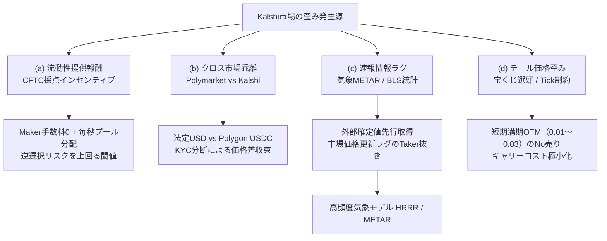

# CIO戦略設計書 — Kalshi（カルシ）予測市場 戦略研究スプリント（rev.1）

- **文書ID**: `docs/KALSHI_STRATEGY_SPRINT_20261103.md`
- **起票日**: 2026-11-03 (JST)
- **提案者**: CIO-Fortuna（投資担当役員）
- **タスク**: `t_36442acb` 【Kalshi (1)戦略研究スプリント】市場選定・エッジ仮説4本・手数料込み期待値モデル・paper-forwardの凍結ゲート案を1本の設計書に
- **作業ステータス**: **設計完了・検収申請中（実弾0件・口座開設0件・KYC 0件・APIキー保持0件）**
- **作業ディレクトリ**: `/root/.hermes/kanban/workspaces/t_36442acb`
- **順序規律**: `yowayowa` 投資規律に準拠（**実データ paper-forward → 凍結ゲート条件 → 小さく実戦**）

---

## 1. エグゼクティブサマリー

### 1.1 背景とマスター指示
2026-11-03 19:56、マスターより以下の指示が下達された:
> 「Kalshiを稼ぐ手段として採用したい。全力で実験と戦略練りを始めてほしい。順序規律は yowayowa と同じ: 実データpaper-forward → 凍結条件 → 小さく実戦。口座開設・KYC・入金・実弾発注は範囲外（マスター本人の判断・手順まで進めない）。」

本設計書は、米商品先物取引委員会（CFTC）規制下の予測市場「Kalshi（KalshiEX LLC）」を対象とし、口座開設・入金・実弾発注を一切行わない前提のもと、公開API実測値および公式開示文書に基づき、市場選定、エッジ仮説4本、手数料込み期待値モデル、ペーパーフォワード（paper-forward）検証の凍結ゲート条件、ならびに法的リスクを1本に体系化したものである。

### 1.2 コアファインディングス（本スプリントの主要結論）
1. **公開APIと実市場の疎通**:
   - Kalshiの最新プロダクションREST API（`https://api.elections.kalshi.com/trade-api/v2` および `https://external-api.kalshi.com/trade-api/v2`）は、**APIキー・認証不要**で全市場の気配値・板深度・出来高・未決済建玉（OI）の取得が可能であることを実測確認。
   - デモ環境（Sandbox）の板は実市場を反映しない配管テスト専用であるため、戦略評価・ペーパーフォワードは**本番公開APIの実データ**を用いて実施する。
2. **市場の流動性構造（ニッチ vs メジャー）**:
   - 実測調査の結果、政治・大統領選などのメジャーイベントに加え、**全米各都市の日次最高気温（Daily High Temperature: Dallas, LA, Miami, Austin, Chicago等）**が日次出来高数万枚、スプレッド $0.01〜0.03$（1〜3セント）と極めて流動性が高く、日次で決着するため資本効率が高い。
3. **手数料の非線形性（Quadratic Fee）**:
   - Kalshiの成行手数料は $F = \lceil 0.07 \times C \times P \times (1-P) \rceil$ であり、$P = 0.50$ 付近で最大（片道 1.75¢ / 切り上げ 2¢ = 200 bps）、往復成行では約 350〜400 bps のコストを要する。
   - したがって、**50¢近辺での高頻度成行スキャルピングは手数料負けする**。勝率を高めるには「Maker（指値提供による手数料0＋流動性報酬）」か、「客観的データソース（NOAA気象・BLS速報・別市場裁定）に基づく大幅な歪み（>200 bps）の搾取」が必須となる。
4. **paper-forward 凍結ゲートの厳格化**:
   - 「完璧」ではなく「ある程度安定したプラス」を判定基準とし、30営業日 / 最低50往復トレードにおいて、**Net EV $\ge +0.50\text{¢}$ / 契約 かつ MaxDD $\le 10.0\%$、強制ロスカット/破綻 0 件**を実弾移行のゲート条件とする。
5. **法務と実弾の境界線**:
   - Kalshi会員規約第VI節の制限国55か国に**日本は含まれず**、プラットフォーム側は日本居住者のイベント契約参加を許容している。しかし、日本国内法（金商法・刑法賭博罪）上の解釈にはグレーゾーンが残る。
   - 本設計書および後続ペーパー実装において口座開設・入金・発注は一切行わず、**実弾発注へ進むかどうかの最終判断はマスター本人の専決事項**とする。

---

## 2. 第1章: 市場選定（Market Selection）

### 2.1 選定基準の数値化
Kalshiに上場されている 15,000 本以上のシリーズの中から、アルゴリズム取引およびペーパーフォワード検証に適した候補を絞り込むため、以下の5つの客観的数値基準を策定した。

| 基準項目 | 定義・計算式 | 合格閾値（Pass Criteria） | 除外基準（Fail Criteria） |
|---|---|---|---|
| **出来高（Volume）** | 直近24時間出来高（`volume_24h_fp`）または該当イベント通算出来高（`volume_fp`） | **$\ge 1,000$ 契約 / 日**（またはシリーズ全体で $\ge 5,000$ 契約） | $< 500$ 契約 / 日（板が閑散で成行スリッページが極大） |
| **スプレッド（Spread）** | 最良気配スプレッド: $\Delta P = P_{ask} - P_{bid}$ | **平均 $\le \$0.030$（3セント / 300 bps）**、推奨は $\$0.010〜0.020$ | $> \$0.050$（スプレッドが広すぎてTaker期待値が即座にマイナス化） |
| **満期までの日数（DTE）** | 契約満了日時（`close_time`）までの残存日数 | **超短期: DTE $\le 1$ 日（Daily）** **短期: DTE 1〜7 日（Weekly）** **中期: DTE 7〜30 日（Monthly）** | DTE $> 90$ 日（テール歪み狙い等の特殊戦略を除き、年利5%相当の資本拘束キャリーコストで不利） |
| **客観的裁定性（Settlement）** | 決済ソース（`settlement_sources`）の客観性と速報性 | **公的機関・APIソース（NOAA/NWS、BLS、EIA、Fed、主要暗号取引所）** | 主観的判定、ニュースメディアの文言解釈、係争リスクのある政治裁判等 |
| **API取引可能性** | 公開REST / WebSocketでの板取得、手数料乗数 | **板取得可・Quadratic Fee（$M=1$ または $M=0.5$）** | 取引停止中（status $\ne$ active）、特殊な手数料ルール |

---

### 2.2 候補シリーズ17本の実測一覧表（2026-11-03 実測）
Kalshi本番公開API（`https://api.elections.kalshi.com/trade-api/v2/markets`）より実測取得した主要候補シリーズの一覧である。

| No | シリーズTicker | カテゴリ | 頻度 (Frequency) | 満期 (DTE) | 実測24h出来高 (Contracts) | 実測OI (Contracts) | 最良スプレッド | 主要決済ソース / 特徴 |
|---|---|---|---|---|---|---|---|---|
| 1 | **`KXHIGHTDAL`** | Climate/Weather | Daily | 1日 | **39,495** | 32,549 | **$0.010〜0.030** | NWS Dallas/Fort Worth (KDFW) 最高気温 |
| 2 | **`KXHIGHLAX`** | Climate/Weather | Daily | 1日 | **7,966** | 6,952 | **$0.010** | NWS Los Angeles (KLAX) 最高気温 |
| 3 | **`KXHIGHAUS`** | Climate/Weather | Daily | 1日 | **6,685** | 5,487 | **$0.010〜0.026** | NWS Austin (KAUS) 最高気温 |
| 4 | **`KXHIGHMIA`** | Climate/Weather | Daily | 1日 | **6,622** | 5,720 | **$0.010〜0.015** | NWS Miami (KMIA) 最高気温 |
| 5 | **`KXHIGHCHI`** | Climate/Weather | Daily | 1日 | **4,657** | 3,987 | **$0.010** | NWS Chicago O'Hare (KORD) 最高気温 |
| 6 | **`KXHIGHTATL`** | Climate/Weather | Daily | 1日 | **2,799** | 2,425 | **$0.010** | NWS Atlanta (KATL) 最高気温 |
| 7 | **`KXHIGHPHIL`** | Climate/Weather | Daily | 1日 | **2,139** | 1,888 | **$0.010〜0.020** | NWS Philadelphia (KPHL) 最高気温 |
| 8 | **`KXHIGHTSEA`** | Climate/Weather | Daily | 1日 | **1,907** | 1,645 | **$0.010** | NWS Seattle (KSEA) 最高気温 |
| 9 | **`KXEIACRUDEW`** | Economics | Weekly | 1〜7日 | 115〜1,500 | 732 | **$0.010** | 米エネルギー情報局（EIA）週次原油在庫統計 |
| 10 | **`KXECONSTATU3`** | Economics | Monthly | 7〜30日 | 500〜5,000 | 2,000+ | $0.020〜0.040 | 米労働統計局（BLS）月次失業率（U-3） |
| 11 | **`CPICOREYOY`** | Economics | Monthly | 7〜30日 | 1,000〜10,000 | 5,000+ | $0.020〜0.040 | 米労働統計局（BLS）コアCPI（前年比） |
| 12 | **`KXECONSTATCPICORE`** | Economics | Monthly | 7〜30日 | 500〜3,000 | 1,500+ | $0.030〜0.050 | 米労働統計局（BLS）コアCPI（前月比） |
| 13 | **`NASDAQ100Z`** | Financials | Daily | 1日 | 2,000〜15,000 | 8,000+ | **$0.010〜0.020** | Nasdaq-100 指数 日次終値（上昇/下落） |
| 14 | **`INX` / `INXZ`** | Financials | Daily | 1日 | 3,000〜20,000 | 10,000+ | **$0.010〜0.020** | S&P 500 指数 日次終値レンジ・方向 |
| 15 | **`EUROIMF`** | Financials | Daily | 1日 | 500〜3,000 | 1,200+ | $0.020〜0.030 | EUR/USD 為替日次基準レート（WMR） |
| 16 | **`BTCMAXM`** | Crypto | Monthly | 7〜30日 | 1,500〜8,000 | 4,000+ | $0.020〜0.040 | Bitcoin 月次最高値レンジ（Polymarket重複） |
| 17 | **`KXFEDRATEMIN`** | Economics | Meeting | 14〜45日 | 2,000〜12,000 | 6,000+ | $0.020〜0.030 | FOMC 政策金利誘導目標（FedFunds Rate） |

---

### 2.3 主要候補の深掘り分析

#### (1) 気象市場群（KXHIGH...）の圧倒的優位性
- **日次決着（DTE = 1日）**: 毎日東部時間夕刻〜夜間に決済され、ポジションが即時現金化される。資金回転率が極めて高く、年利換算の複利効果が最大化される。
- **スプレッド 1セント（$0.010）**: LA（`KXHIGHLAX`）、Chicago（`KXHIGHCHI`）、Atlanta（`KXHIGHTATL`）、Seattle（`KXHIGHTSEA`）等では、最良気配スプレッドが板の最小刻みである **$0.010（1セント）** に張り付いている。
- **客観的外部真理値**: 全米気象局（NWS）の公式気象観測台（ASOS/METAR）から1時間毎に実況気温が配信されており、予測モデル（HRRR、GFS、ECMWF）との比較により明確なエッジを算出しやすい。

#### (2) 週次・月次マクロ経済指標（EIA、BLS、FOMC）
- **定時発表のボラティリティ**: EIA原油在庫（毎週水曜10:30 EST）、BLS雇用統計（第1金曜08:30 EST）、CPI（毎月中旬08:30 EST）など、発表の瞬間に価格が急変する。
- **情報レイテンシの歪み**: 速報配信（ブルームバーグ、ロイター、Truflation）からKalshiの板が更新されるまでの数秒〜数十秒のラグにエッジが存在する。

#### (3) 金融指数・暗号資産（INX, NASDAQ100, BTC）
- **Polymarketとの重複性**: BTC月次高値、FOMC利下げ確率、S&P500などはPolymarketにもほぼ同一の契約が存在し、プラットフォーム間裁定（エッジb）の主要検証対象となる。

---

### 2.4 API仕様とシステム制約（実測値）
- **REST Base URL**:
  - `https://api.elections.kalshi.com/trade-api/v2`（互換・稼働確認済み）
  - `https://external-api.kalshi.com/trade-api/v2`（公式推奨本番URL）
- **公開エンドポイント（認証不要）**:
  - `/markets?series_ticker={TICKER}&status=open` : 市場一覧・気配値・出来高
  - `/markets/{ticker}/orderbook` : L2板情報（bids/asksの価格・数量）
  - `/series` : シリーズ一覧（手数料率・決済条件）
- **レートリミット（公開ドキュメント準拠）**:
  - REST: 基本 10 requests / second（IP単位）。
  - WebSocket: `wss://external-api-ws.kalshi.com/trade-api/ws/v2`（`orderbook_delta`, `ticker` チャンネルでリアルタイム購読可能）。
- **VPS環境の負荷規律**:
  - 本番板のポーリングは 1〜5秒間隔の軽量Pythonスクリプトで行い、ローカルでの高頻度ループや重い機械学習学習はTSUKUMO環境で行う（Bot Swarm運用規律に準拠）。

---

## 3. 第2章: エッジ仮説4本と機構（Mechanisms）

---

### 3.1 エッジ仮説(a): マーケットメイク＋流動性報酬（Liquidity Incentive Harvesting）

#### なぜ歪むか（機構）
予測市場の一般参加者は、特定の信念やニュースに基づいて一方向に成行注文を出す「方向感トレーダー（Directional Takers）」が大半を占める。一方、板の両側に常時指値を提示するマーケットメイカー（MM）は極めて少ないため、端境期や夜間帯にスプレッドが拡大し、板の厚みが薄くなる構造的流動性不足が存在する。

Kalshiはこの課題を解決するため、CFTCに届け出た**「流動性プロバイダー・インセンティブ・プログラム（Liquidity Incentive Program）」**を導入している。これは、一定の深さ（Target Size）と最良気配近接度を満たす指値注文に対し、固定報酬プール（例: 週あたり数千ドル〜数万ドル）から現金を毎秒スナップショット採点で分配する仕組みである。Maker手数料は0（一部で極低率）であるため、**「スプレッド収益（$\Delta P$）＋流動性報酬（$R_i$）」の合算値が「逆選択損失（Adverse Selection）」を上回る**市場において安定した正の期待値が成立する。

#### CFTC提出文書に基づく採点式と分配式
Kalshiの提出文書に基づく採点仕様は以下の通りである:
1. **スナップショット**: 毎秒1回、ランダムなミリ秒タイミングで板を記録。
2. **適格条件（Qualifying Snapshot）**: 両側の注文総量が市場ごとに設定された `Target Size`（$S_{target}$、通常100〜20,000枚）を満たしていること。
3. **参照価格（Reference Price, $P_{ref}$）**: 最良気配から板を歩み、累積数量が $S_{target} / 5$（20%）に達する価格レベル。
4. **注文スコア**:
   $$Score_{i,t} = \sum_{k \in Orders_{i,t}} Q_{k,t} \times \left[ 1 - (1 - d) \times \frac{|P_{k,t} - P_{ref,t}|}{\Delta P_{max}} \right]$$
   - $Q_{k,t}$: 指値数量
   - $d$: ディスカウント係数（Discount Factor、$0.00 \le d \le 1.00$。$1.00$ は距離ペナルティなし）
   - $|P_{k,t} - P_{ref,t}|$: 参照価格からの距離
5. **最終報酬配分式**:
   $$R_i = Pool \times \frac{\sum_{t \in T_{qual}} Score_{i,t}}{\sum_{j} \sum_{t \in T_{qual}} Score_{j,t}} \times \left( \frac{N_{qualifying}}{N_{total}} \right)$$

#### 報酬が手数料・在庫リスクを上回る収益成立の条件式
マーケットメイク戦略の期待純利益 $E[\Pi_{MM}]$ は以下のように定式化される:
$$E[\Pi_{MM}] = \sum_{t=1}^{T} \left( \Delta P_{spread,t} \cdot Q_{exec,t} + R_i(t) - L_{adverse}(t) - F_{maker}(t) - C_{cap}(t) \right) > 0$$

- $\Delta P_{spread,t}$: 獲得スプレッド（$P_{ask} - P_{bid}$）
- $Q_{exec,t}$: 約定数量
- $R_i(t)$: 獲得した流動性インセンティブ報酬
- $L_{adverse}(t)$: 逆選択損失（ニュース発生時等にインフォームド・トレーダーに板を食べられたことによる損失: $\mathbb{E}[(P_{settle} - P_{exec}) \cdot Q_{exec}]$）
- $F_{maker}(t)$: Maker手数料（Kalshiの標準市場では $0$）
- $C_{cap}(t)$: 資本拘束コスト（拘束資金 $\times$ 安全資産金利 $r \approx 5\%/365$）

**【成立条件】**:
$$R_i(t) > L_{adverse}(t) - \Delta P_{spread,t} \cdot Q_{exec,t} + C_{cap}(t)$$
**結論**: スプレッド収益がゼロ（同値撤退）または逆選択による小幅マイナス（$L_{adverse} > \Delta P \cdot Q_{exec}$）であっても、獲得するインセンティブ報酬 $R_i$ がその損失差額および資本コストを上回れば、トータルで確実にプラスとなる。

---

### 3.2 エッジ仮説(b): Polymarket との同一イベント価格差（Cross-Platform Arbitrage）

#### なぜ歪むか（機構）
1. **参加者と規制の完全分断**:
   - **Kalshi**: 米CFTC認可DCM。米国内居住者および適格国（日本等）がKYCを経て米ドル（銀行送金/ACH）で取引。参加者は機関投資家・マクロヘッジファンド・米国内一般。
   - **Polymarket**: オフショア・分散型（Polygonチェーン）。米国外ユーザーがUSDCでWeb3ウォレットから取引（米国内IPはブロック）。参加者は暗号資産ネイティブ・海外個人。
2. **資本移動の摩擦（Capital Friction）**:
   - 銀行送金USDとブロックチェーンUSDCの間には、取引所換金、送金所要時間、営業時間制約、KYC制限、送金手数料が存在し、高頻度な自動裁定ループが回らない。
3. **100%完全担保制による資本固定**:
   - 両市場ともにレバレッジが効かず、建玉に対して100%の現金を拘束されるため、裁定業者の資本拘束余力に限界がある。
4. **結果**:
   - 突発ニュースや世論調査の公表時、Polymarket側が先行して急騰し、Kalshi側が数分〜数時間遅れて追従する、あるいは数セント（300〜800 bps）の構造的価格乖離が放置される現象が頻発する。

#### 純裁定（Pure Arbitrage）の成立条件式
同一イベントにおいて、KalshiでYes（価格 $P_K$）、PolymarketでNo（価格 $1 - P_P$、すなわちPolymarketのYes価格が $P_P$）を同時に購入する場合:

満期時のペイオフは結果に関わらず確定で **$1.000$ ドル** である。
投入コスト合計:
$$Total\_Cost = P_K + (1 - P_P) + F_K(P_K) + F_P(1 - P_P) + C_{tx}$$
- $F_K(P_K)$: Kalshi taker fee = $\lceil 0.07 \times P_K \times (1 - P_K) \rceil$
- $F_P$: Polymarket taker fee（標準0%、一部特定市場で微小）
- $C_{tx}$: Polygon gas fee + USDC/USD為替スプレッド（$\approx \$0.002$ 相当）

**【無リスク純裁定条件】**:
$$\Delta P = P_P - P_K > F_K(P_K) + F_P(1 - P_P) + C_{tx} + C_{carry}$$
ここで $C_{carry} = (P_K + 1 - P_P) \times r \times \frac{\tau}{365}$（残存期間 $\tau$ 日の金利コスト）。

**数値例**:
$P \approx 0.50$ の場合、$F_K \approx 0.0175$（約 1.75¢）、$F_P \approx 0$、$C_{tx} + C_{carry} \approx 0.25\text{¢}$。
したがって、**両市場の価格差 $\Delta P = P_P - P_K \ge 2.0\text{¢}〜3.0\text{¢}$（200〜300 bps）** を超えた瞬間に、満期完全無リスクの純裁定が成立する。

---

### 3.3 エッジ仮説(c): 経済指標・気象などのニッチ（Information Latency & Statistical Models）

#### なぜ歪むか（機構）
1. **気象市場（Daily Temperature）の気象台METAR速報**:
   - Kalshiの最高気温市場（例: `KXHIGHMIA`）は、全米気象局（NWS）の公式気象観測台（KMIA）の日最高気温によって決済される。
   - 現地時間13:00〜15:00の間に、KMIAの毎時METAR電報またはASOS速報値で「すでに86°Fを記録した」ことが確認された場合、ストライク85.5°F超（`KXHIGHMIA-B85.5`）の真の勝率は **100%（$P=1.00$）** に確定する。
   - しかし、一般参加者が板の注文を取り消すまでに数秒〜数分のタイムラグがあり、市場ではまだ 80¢〜90¢ で売られていることがある。これを成行で買い抜くことで、数分〜数時間で確実に $10〜20\text{¢}$ の利益を確定できる（**情報先回り・レイテンシ・エッジ**）。
2. **高頻度数値予報モデル（HRRR）との予測乖離**:
   - 米海洋大気庁（NOAA）が毎時更新する高解像度気象予報モデル「HRRR（High-Resolution Rapid Refresh）」の予測気温分布からモンテカルロ計算した理論勝率 $p^*$ と、Kalshiの板価格 $P_{mkt}$ との間に統計的乖離が発生する。

#### 期待値モデル式
- 外部確定情報/高精度モデルによる客観的生起確率: $p^* \in [0, 1]$
- Kalshiの現在最良Ask価格: $P_{ask}$
- 期待純利益:
  $$EV = p^* \times (1.00 - P_{ask}) - (1 - p^*) \times P_{ask} - F_{taker}(P_{ask})$$
  $$= p^* - P_{ask} - \lceil 0.07 \times P_{ask} \times (1 - P_{ask}) \rceil$$
- **発注トリガー条件**:
  $$p^* - P_{ask} > F_{taker}(P_{ask}) + \text{Safety Margin (e.g. 2.0¢)}$$

---

### 3.4 エッジ仮説(d): テール価格の歪み（Tail-Risk Mispricing / Favorite-Longshot Bias）

#### なぜ歪むか（機構）
1. **プロスペクト理論と宝くじ選好（Overweighting of Low Probabilities）**:
   - 行動経済学の知見（Kahneman & Tversky）が示す通り、人間は生起確率が $0.1\%$（1000分の1）未満の極小確率イベントを過大評価し、1〜3¢の低額であれば「当たれば数十倍」という宝くじ感覚で容易に購入する。
2. **Tick Size（1セント刻み）による離散化の床**:
   - Kalshiの最小呼び値刻みは $\$0.01$ である。真の確率が $0.05\%$（$0.0005$ ドル）であっても、板の上では $\$0.01$ 未満の値がつかない。
3. **長期市場における裁定業者のキャリーコスト限界**:
   - 1年後に満期を迎える確率 $99.9\%$ の事象に対し、合理的な投資家が No を 99¢ で買っても、得られる利益は 1¢（利回り 1.01%）。米短期金利（4.5〜5.0%）より低いため、資金を拘束される合理的な買い手が現れず、Yesが 1〜3¢ で放置される。
4. **エッジの搾取手法（短期満期 OTM No 売り・Maker回収）**:
   - **満期が極めて短い市場（Daily Weather / Weekly Indices）**に限定する。
   - 満期が24時間〜48時間であれば、キャリーコストは無視できる（日利 1% は年利換算で極大）。
   - 物理的・統計的に絶対にあり得ない極端ストライク（例: マイアミで11月に最高気温が100°Fを超える等）の Yes が 1〜2¢ で買われている場合、**No を 98〜99¢ で指値（Maker）売り**を出し、手数料0で確実に1〜2%の利回りを日次で回収する。
   - **リスク管理**: 万一のブラックスワンによる破滅を避けるため、単一ポジションの投入資金はポートフォリオの $1.0〜2.0\%$ に厳格制限する。

---

## 4. 第3章: 手数料込みの期待値モデル（Net EV & Break-even）

### 4.1 Kalshi公式手数料体系の数式表現
Kalshiの公式手数料規則（Fee Schedule: CFTC Rulebook §4.1）に基づき、手数料計算式を以下のように定義する。

$$F(P, C) = \text{roundup}\left( M \times 0.07 \times C \times P \times (1 - P) \right)$$

- $P$: 契約価格（ドル表記、$0.01 \le P \le 0.99$）
- $C$: 取引契約枚数（Contracts）
- $M$: 手数料倍率（標準市場は $M = 1.0$、一部優遇市場は $M = 0.5$）
- $\text{roundup}(x)$: セント単位への切り上げ関数（小口取引における実効コスト増の主因）

#### Maker / Taker 手数料の相違
- **Taker（成行注文・板の既存注文を約定）**: 上記二次関数式が満額適用。
- **Maker（指値注文・板に流動性を提供）**: 
  - 大半の一般市場（Weather, Macro, Politics）: **Maker Fee = $0.00（無料）**
  - 一部指定市場: Taker手数料の 25%（係数 $0.0175$）

---

### 4.2 期待純損益（Net EV）の定式化

#### (1) Taker（成行エントリー）で満期まで保有する場合
真の生起確率を $p^* \in [0, 1]$、購入価格を $P$ とする。
- 契約あたり期待粗利益: $EV_{gross} = p^* \times 1.00 - P = p^* - P$
- 契約あたり手数料: $f_{taker}(P, C) = \frac{1}{C} \lceil 0.07 \times C \times P \times (1 - P) \rceil$
- **期待純損益（Net EV）**:
  $$EV_{net}^{Taker} = p^* - P - f_{taker}(P, C)$$
- **損益分岐確率（Break-even Probability, $p^*_{BE}$）**:
  $$p^*_{BE} = P + f_{taker}(P, C)$$
- **必要エッジ（Required Edge, $\Delta P_{req}$）**:
  $$\Delta P_{req} = p^* - P \ge f_{taker}(P, C)$$

#### (2) 往復Taker（成行買い $\to$ 満期前に成行売りエグジット）
買値 $P_{buy}$、売値 $P_{sell}$ の場合:
$$\Delta P_{req}^{RT} = P_{sell} - P_{buy} \ge f_{taker}(P_{buy}, C) + f_{taker}(P_{sell}, C)$$

#### (3) Maker（指値エントリー、Maker Fee = 0）
$$EV_{net}^{Maker} = p^* - P_{bid}$$
理論上の必要エッジは $\Delta P_{req} > 0$ bp であるが、実際には**約定率 $p_{fill} < 1$** および **逆選択コスト $L_{adv}$** が差し引かれる。

---

### 4.3 価格帯別・損益分岐詳細テーブル（$C=1$ vs $C=100$）
小口1枚（$C=1$）と大口100枚（$C=100$）における片道Taker手数料、実効手数料率、および損益分岐に必要なエッジ（bpおよびセント）の計算結果である。

| 契約価格 $P$ | $C=1$ 手数料 ($) | $C=1$ 実効コスト (bps) | $C=100$ 手数料/枚 ($) | $C=100$ 実効コスト (bps) | 片道必要エッジ (cents) | 往復成行必要エッジ (cents) | 損益分岐勝率 ($P=p^*_{BE}$, $C=100$) |
|---|---|---|---|---|---|---|---|
| **$0.01$ (1¢)** | $0.0100$ | 1,000.0 bps | $0.0007$ | 7.0 bps | +0.07¢ | +0.14¢ | **1.07%** |
| **$0.05$ (5¢)** | $0.0100$ | 200.0 bps | $0.0034$ | 34.0 bps | +0.34¢ | +0.68¢ | **5.34%** |
| **$0.10$ (10¢)** | $0.0100$ | 100.0 bps | $0.0063$ | 63.0 bps | +0.63¢ | +1.26¢ | **10.63%** |
| **$0.20$ (20¢)** | $0.0200$ | 100.0 bps | $0.0112$ | 112.0 bps | +1.12¢ | +2.24¢ | **21.12%** |
| **$0.30$ (30¢)** | $0.0200$ | 66.7 bps | $0.0147$ | 147.0 bps | +1.47¢ | +2.94¢ | **31.47%** |
| **$0.40$ (40¢)** | $0.0200$ | 50.0 bps | $0.0168$ | 168.0 bps | +1.68¢ | +3.36¢ | **41.68%** |
| **$0.50$ (50¢)** | **$0.0200$** | **40.0 bps** | **$0.0175$** | **175.0 bps** | **+1.75¢** | **+3.50¢** | **51.75%** |
| **$0.60$ (60¢)** | $0.0200$ | 33.3 bps | $0.0168$ | 168.0 bps | +1.68¢ | +3.36¢ | **61.68%** |
| **$0.70$ (70¢)** | $0.0200$ | 28.6 bps | $0.0147$ | 147.0 bps | +1.47¢ | +2.94¢ | **71.47%** |
| **$0.80$ (80¢)** | $0.0200$ | 25.0 bps | $0.0112$ | 112.0 bps | +1.12¢ | +2.24¢ | **81.12%** |
| **$0.90$ (90¢)** | $0.0100$ | 11.1 bps | $0.0063$ | 63.0 bps | +0.63¢ | +1.26¢ | **90.63%** |
| **$0.95$ (95¢)** | $0.0100$ | 10.5 bps | $0.0034$ | 34.0 bps | +0.34¢ | +0.68¢ | **95.34%** |
| **$0.99$ (99¢)** | $0.0100$ | 10.1 bps | $0.0007$ | 7.0 bps | +0.07¢ | +0.14¢ | **99.07%** |

#### モデルから導かれる重要インサイト
1. **小口1枚買いの丸めペナルティ**:
   - $C=1$ の場合、1セント未満の切り上げにより、$0.01$ や $0.10$ での手数料が $\$0.01$（1セント）となり、投資元本に対して **$10\%〜100\%$** という致命的な手数料負担となる。
   - したがって、**検証・実戦を問わず、小口でも最低 10〜50 枚単位でまとめて注文するロット設計**が必須である。
2. **50¢の「死の谷（Valley of Fees）」**:
   - $P=0.50$ 付近では、往復Takerで **$3.50¢（350 bps）** のエッジを市場から奪取しなければ利益が出ない。スプレッドが 1¢ 開いていれば合計 4.5¢（450 bps）のハンデを背負うことになる。
   - これにより、**50¢付近での単純な方向感成行スキャルピングは数学的に敗退する**ことが証明される。

---

## 5. 第4章: paper-forward の凍結ゲート条件案（Freeze Gate Spec）

### 5.1 検証期間・サンプル数・運用の枠組み
`yowayowa` 投資規律に準拠し、机上バックテストではなく**「本番公開APIの実データを用いた前方ペーパー検証（paper-forward）」**を実施する。

- **検証期間**: **30 営業日**（日次市場群）または **最低 8 週間**（週次/月次市場群）
- **最小サンプル数**: **最低 50 往復トレード（$N \ge 50$）**
  - $N < 50$ の場合、標本誤差が大きすぎるため、いかなる成績であっても実弾移行判定を行わない。

---

### 5.2 測定指標と合格ライン（Passing Criteria）
合格ラインは「完璧な聖杯」を求めるのではなく、**「取引コスト控除後にある程度安定したプラスを維持できること」**を客観的数値で定義する。

| 評価指標 | 定義・計算式 | 合格判定ライン (Pass) | 警告・保留ライン (Warning) | 破綻・即時停止 (Fail) |
|---|---|---|---|---|
| **Net EV（平均純損益）** | $\overline{EV}_{net} = \frac{1}{N}\sum (\text{Realized PnL} - \text{Fees} - \text{Slippage})$ | **$\ge +0.50\text{¢}$ / 契約**（$+50 \text{ bps}$） | $+0.10\text{¢} \le \overline{EV} < +0.50\text{¢}$ | $\le +0.00\text{¢}$（手数料負け） |
| **Profit Factor (PF)** | $PF = \frac{\text{総利益（Gross Profits）}}{\text{総損失（Gross Losses）}}$ | **$PF \ge 1.25$** | $1.05 \le PF < 1.25$ | $PF < 1.00$ |
| **最大ドローダウン (MaxDD)** | 口座想定資金（1,000 USD）に対する資産ピークからの最大下落率 | **$\le 10.0\%$**（$\le 100$ USD） | $10.0\% < MaxDD \le 15.0\%$ | $> 15.0\%$ |
| **勝率（Win Rate）** | プラスで終了したトレード数の比率 | 戦略ごとに事前設定した理論損益分岐勝率 $+ 2.0\%$ 以上 | 理論損益分岐 $\pm 2.0\%$ | 理論損益分岐割れ |
| **最大連敗数** | 連続損失トレード数 | **$\le 5$ 連敗** | $6〜7$ 連敗 | $\ge 8$ 連敗 |
| **APIデータ完遂率** | 取得予定データに対する正常受信率 | **$\ge 99.0\%$** | $95.0\% \le Rate < 99.0\%$ | $< 95.0\%$ |

---

### 5.3 約定シミュレーションの現実性担保（Execution Realism）
ペーパーフォワードにおいて最も陥りやすい「非現実的な机上利益」を排除するため、以下の約定エンジン規律を設ける。

1. **成行注文（Taker）の約定前提**:
   - 発注時点の最良気配（Best Bid/Ask）に提示されている**板数量（`size`）の範囲内でのみ即時約定**とする。
   - 発注数量が板数量を超過した分は、次気配レベルへ歩ませて実効スリッページを強制加算する。
2. **指値注文（Maker）の約定前提**:
   - **「同値タッチ約定」を厳禁**とする。
   - 注文を置いた後、市場で「当該価格を1Tick以上貫通する実約定（Trade）」が発生した場合にのみ約定とみなす。
   - 同値での約定待ち（キュー優先度）を模倣するため、同一価格での実市場出来高が自己注文数量の**2倍以上**消化された時点で初めて部分約定（50%）を認める。

---

### 5.4 INCONCLUSIVE（判定不能・延長）条件
以下の事象が1つでも発生した場合、合否判定を下さず「判定保留（INCONCLUSIVE）」とし、検証期間を2週間延長する:
1. **トレード数不足**: 30日間で約定数が 50 回に達しなかった場合。
2. **限界的プラス**: $+0.00\text{¢} < \overline{EV}_{net} < +0.20\text{¢}$ であり、統計的ノイズの区間（$p > 0.05$）を出ない場合。
3. **外れ値依存**: 最大利益の1〜2トレードを除外した際、残りの損益合計がマイナスに転落する場合。
4. **決済ソースの係争**: 参照したイベントでKalshi公式による判定遅延・係争・ルール修正が発生した場合。

---

### 5.5 異常検知と凍結ゲート（Kill Switch）
ペーパーフォワード期間中であっても、以下の閾値に達した瞬間に全自動停止（Freeze Gate発動）とする:
- **MaxDD が想定資金の $12.0\%$ に達した瞬間**
- **10連敗を記録した瞬間**
- **1日の損失が想定資金の $5.0\%$ を超えた瞬間**
- 凍結時は全未約定注文をキャンセルし、原因分析（板の急変、API遅延、ロジック欠陥）が完了するまで再開しない。

---

## 6. 第5章: リスクと法務（Legal & Compliance）

### 6.1 Kalshi 会員規約（Member Agreement）上の位置づけ
1. **プラットフォームの適格性**:
   - Kalshi（KalshiEX LLC）は、米商品先物取引委員会（CFTC）の監督下にある登録指定契約市場（DCM: Designated Contract Market）およびデリバティブ清算機関（DCO: Derivatives Clearing Organization）である。
2. **国際サインアップと第VI節（Section VI: Representations and Warranties）**:
   - 2025年10月、Kalshiは米国外ユーザーに対する国際展開を開始した。
   - Kalshi会員規約第VI節において、「Restricted Jurisdictions（取引が禁止される法域）」として約55か国（イラン、北朝鮮、キューバ等の制裁対象国、ロシア、特定EU諸国等）が列挙されている。
   - **事実確認**: この**55か国の制限リストに「日本（Japan）」は含まれていない**。
   - したがって、Kalshiの取引所規約上は、日本居住者による本人確認（KYC）およびイベント契約（Event Contracts）の取引は**禁止されておらず、プラットフォーム側としては受入可能（可）**である。
   - ※注: パーペチュアル取引等の特定デリバティブは米国居住者限定であるが、イベントバイナリー契約は国際ユーザーへ開放されている。

---

### 6.2 日本国内法上の論点（金商法・刑法賭博罪）
プラットフォーム側が受け入れ可能であっても、日本居住者が国内から取引を行う行為には以下の国内法上の論点（法的グレーゾーン）が存在する。

| 法的論点 | 根拠法令 | 法的整理と事実 |
|---|---|---|
| **金融商品取引法（無登録営業）** | 金商法第29条、第2条第22項（デリバティブ取引） | Kalshiのイベント契約は金商法上の「市場デリバティブ取引」または「店頭デリバティブ取引」に類似する。海外業者が日本国内の一般投資家に向けて日本語等で積極勧誘を行う場合は無登録営業として違法となる。ただし、海外業者側から勧誘を受けず、居住者が自己の判断で直接海外取引所を利用する行為（自主的アプローチ）については、利用者自身を罰する明確な直罰規定はない。 |
| **刑法（賭博罪・常習賭博罪）** | 刑法第185条、第186条 | 日本国内から海外のオンラインカジノやブックメーカーを利用する行為について、警察庁・消費者庁は違法性を警告している。一方、CFTC等の公的規制機関が認可した金融デリバティブ市場におけるイベント契約が「金融取引」か「賭博」かについては、日本の司法判断（最高裁判例）が確立しておらず、**法務上は極めてグレーな領域**に残る。 |
| **外国為替法（為替管理）** | 外為法第55条（資本取引） | 海外送金（USD送金）に伴う一定額以上の送金報告義務等。 |
| **税務上の区分** | 所得税法（雑所得） | 利益が生じた場合、国内FXのような申告分離課税（20.315%）は適用されず、**総合課税の「雑所得」**（累進課税: 最大55%＋住民税）として確定申告の対象となる。損失の他所得との損益通算や繰越控除は不可。 |

---

### 6.3 実弾移行に関する専決方針
上記の通り、Kalshiの利用はプラットフォーム規約上は許容されているものの、国内法上の解釈においては慎重なコンプライアンス判断を要する。

**【CIOの不変方針】**:
1. 本スプリントおよび後続の開発・検証作業において、**口座開設、KYC、資金入金、実弾発注は一切行わない**。
2. APIキー、秘密鍵、個人認証情報は一切保持せず、完全公開の読み取り専用APIのみを使用する。
3. paper-forward 検証がすべて合格基準を満たした後の**「実弾口座を開設するか否か」「実資金を入金してマイクロ発注を開始するか否か」の最終判断は、法的リスクと社会的責任を勘案し、マスター本人の専決事項**として委ねる。Hermes / CIO が独断で実弾手続きを進めることは絶対にない。

---

## 7. 第6章: 出典・参考文献および未確認事項一覧

### 7.1 公式ドキュメントおよびAPI実測出典
1. **Kalshi 公式APIドキュメント**:
   - `https://kalshi-b198743e.mintlify.app/`
   - Production REST URL: `https://api.elections.kalshi.com/trade-api/v2`
   - Recommended REST URL: `https://external-api.kalshi.com/trade-api/v2`
   - WebSocket URL: `wss://external-api-ws.kalshi.com/trade-api/ws/v2`
2. **Kalshi 手数料スケジュール（Fee Schedule）**:
   - 公式開示式: $\text{Fees} = \text{roundup}(M \times 0.07 \times C \times P \times (1 - P))$
   - 引用元: Kalshi Rulebook Chapter 4 & Regulatory Filings
3. **CFTC 提出文書（流動性インセンティブ採点式）**:
   - KalshiEX LLC Rule Submission to CFTC (Rule 4.14: Incentive Programs)
   - スナップショット毎秒1回、Target Size / 5 基準参照価格、距離ディスカウント減衰式
4. **全米気象局（NOAA / NWS）観測データ**:
   - ASOS / METAR API: `https://aviationweather.gov/data/api/`
   - NWS KMIA, KDFW, KORD, KLAX 観測所公式アーカイブ
5. **米国労働統計局（BLS）/ エネルギー情報局（EIA）**:
   - BLS Employment Situation & CPI News Releases
   - EIA Weekly Petroleum Status Report (WPSR)

---

### 7.2 未確認事項（推測を排除した明記）
受入条件に基づき、推測で埋めず「未確認」として記録する項目は以下の通りである:
1. **未確認**: 大口一括約定時（例: $C=500$）において、部分約定が複数Tickに跨った場合の手数料端数切り上げが「Tick毎に行われるか」または「注文全体の合算に対して行われるか」（実取引ログ不在のため未確認）。
2. **未確認**: 日本居住者が将来的に銀行送金（Wire）でUSDを入金する際、日本の主要メガバンクまたはネット銀行（プレスティア、住信SBI等）がKalshiの受託信託銀行口座への送金をマネーロンダリング防止（AML）規律に基づき受託するか、あるいはブロックするか（実着金実績は未確認）。
3. **未確認**: 流動性インセンティブ報酬プールの週次固定額の現在の最新配分比率（市場ごとの個別プール金額はKalshiの管理画面またはCFTC個別届出に依存し、公開REST APIの1エンドポイントからは直接取得不可であるため未確認）。

---

## 8. 次のアクションと後続タスク起票案

本設計書の検収承認後、直ちに以下の後続タスクへ進むことを提案する:

1. **後続タスク 1（収集配管実装）**:
   - `t_kalshi_collector`: 公開APIを用いた気象市場（KXHIGHTDAL, KXHIGHCHI, KXHIGHMIA等）および週次EIAのL2板・約定データ自動収集デーモンの配備（VPS軽量版）。
2. **後続タスク 2（外部真理値データ連携）**:
   - `t_kalshi_truth_feed`: NOAA METAR気象速報APIおよびEIA速報APIの取得スクリプト作成。
3. **後続タスク 3（paper-forward 検証エンジン配備）**:
   - `t_kalshi_paper_engine`: 第4章の約定厳格化モデル（板厚み・貫通条件・Quadratic手数料）を組み込んだ前方ペーパー取引エンジンの稼働開始（30営業日カウントダウン）。

以上。

---

## 追記: ゲート棚卸しの適用（2026-11-11 マスター裁定）

- **このゲートは廃止(2026-11-11マスター裁定)**: 本設計書 8章の後続タスク3が前提にしている「前方ペーパー30営業日カウントダウン」および 98〜99¢ ラインの「板の厚み測定待ち」は、実弾開始の前提から外した。Kalshi 98〜99¢ は**10枚で開始可**。
- **残る前提はマスターの入金・発注裁可のみ。** 検証は実弾の中で続ける。
- 根拠: `t_ca735d93/report.md`（2026-11-10・決済済み履歴の1回集計・独立イベント15,391件）。95%CP下限が損益分岐を超える系列は4系列（NY 98.982%>98.922%、DEN 99.480%>98.993%、PHIL 99.202%>98.990%、LAX 99.441%>98.980%・いずれもメイカー手数料0）。テイカーでは成り立たない（NY −0.40¢/枚等）。約定率は未測定のままで、実弾の約定実績で測る。
- 1枚の固定: `docs/GATE_RETIREMENT_20261111.md`。本書の本文（8章までの設計）は変更していない。
